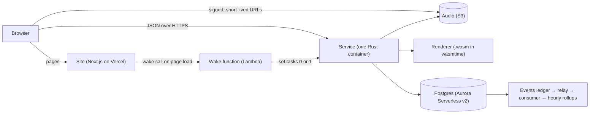
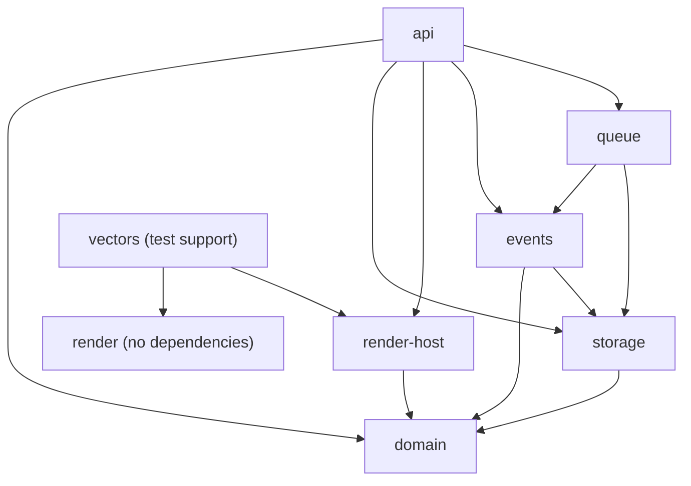
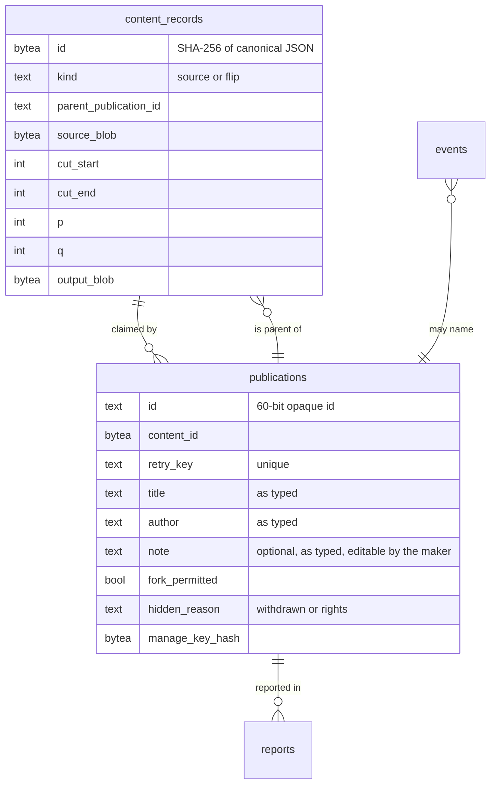
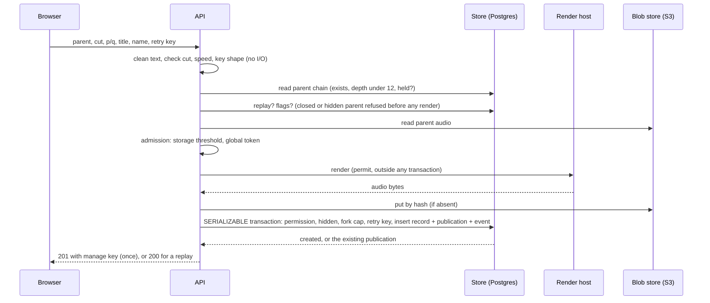
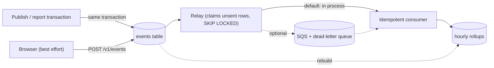
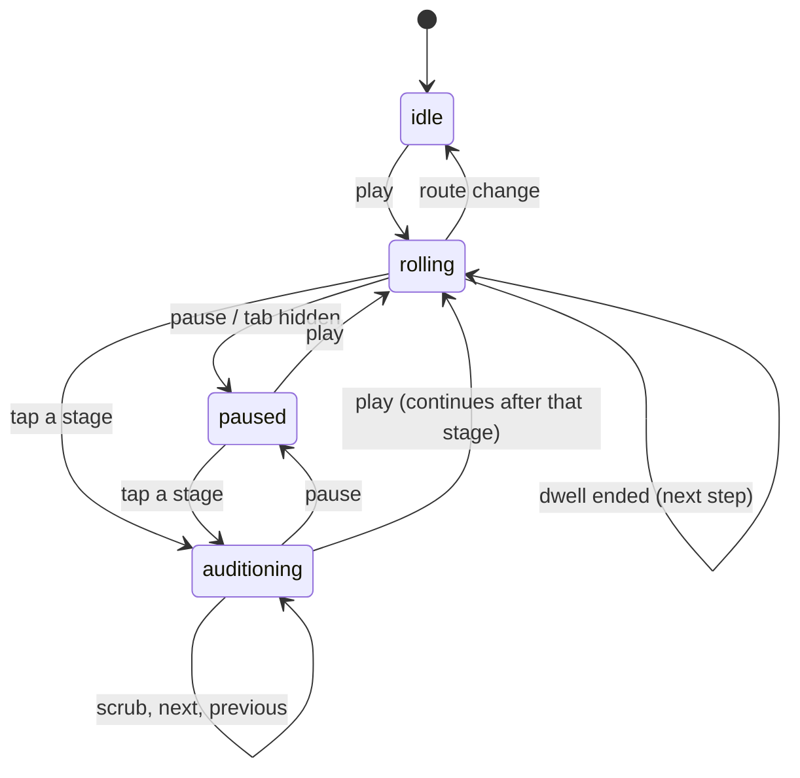
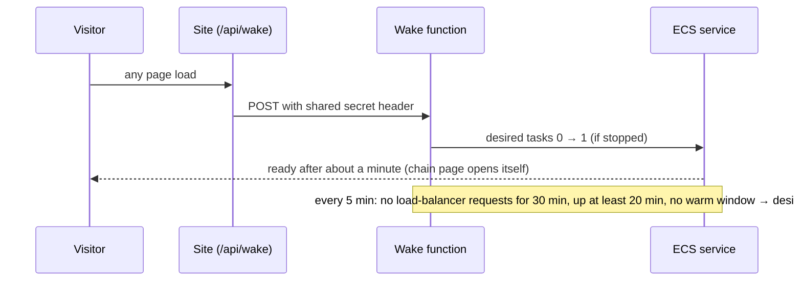

# Architecture

How graft is built, why, and what is known to be weak. For what graft is and how to try it, read the [README](README.md). Each section ends with the files to read; names are symbols and paths, not line numbers, so they stay true.

**Contents.** [Overview](#overview) · [Module boundaries](#module-boundaries) · [Determinism contract](#determinism-contract) · [Determinism evidence](#determinism-evidence) · [Data model](#data-model) · [Publishing a flip](#publishing-a-flip) · [Concurrency and idempotency](#concurrency-and-idempotency) · [Ownership and moderation](#ownership-and-moderation) · [Abuse guardrails](#abuse-guardrails) · [Blobs](#blobs) · [Events and the outbox](#events-and-the-outbox) · [First open and the static snapshot](#first-open-and-the-static-snapshot) · [Playback model](#playback-model) · [The web app](#the-web-app) · [Hosting and environments](#hosting-and-environments) · [Configuration](#configuration) · [Observability and operations](#observability-and-operations) · [Operator runbook](#operator-runbook) · [Security](#security) · [Measured numbers](#measured-numbers) · [Testing](#testing) · [Decisions and trade-offs](#decisions-and-trade-offs) · [Known debt](#known-debt) · [Roadmap](#roadmap)

## Overview

graft stores a sound's ancestry and plays it back as credits. A **flip** is a cut of a parent sound at a changed speed. Every flip names exactly one parent, so a sound's past is a single line of at most twelve **stages** (the **chain**), from a **source** to the newest flip.

The one idea the rest of the design serves: **the audio of every stage is produced by one integer-only renderer, and the same bytes come out in the browser and on the server.** A maker previews a flip in the page with the exact `.wasm` the service will run, so what they hear is what gets stored, and anyone can re-render a stage and compare hashes.



| Part | What it does | Where |
|---|---|---|
| Renderer | Cut + speed → audio, integers only, no floats | `crates/render` |
| Render host | Runs the pinned `.wasm` under wasmtime with fuel and memory limits | `crates/render-host` |
| Domain | Records, ancestry, honesty states, text rules, limits; depends on nothing | `crates/domain` |
| Storage | Postgres store, blob stores (memory, directory, S3), orphan cleanup | `crates/storage` |
| Events | Outbox relay, idempotent consumer, hourly rollups | `crates/events`, `crates/queue` |
| API | HTTP routes, guardrails, config, OpenAPI, seed commands | `crates/api` |
| Site | Roll, record, make flow, sketches, perform | `web/` |
| Wake | Starts the service on a visit, stops it when idle | `tools/wake`, `scripts/aws-dev.sh` |

## Module boundaries

One deployable Rust service plus the site, as a Cargo workspace. The dependency arrows are checked in CI by `scripts/check-crate-graph.mjs`, which fails on any edge (normal, dev or build) that is not drawn here.



- `render` has no dependencies at all: it must build alone into a reproducible `.wasm`.
- `render-host` depends on `domain` only, and CI fails if it gains any HTTP, socket or async-runtime crate.
- `Store` in `storage` is a concrete type, not a trait. The test seam is a real Postgres, so a trait would never have a second implementation.
- The AWS SDK lives in `queue` and nowhere else, so the many test binaries that link other crates never build it.
- Nothing depends on `api`.

Conventions, all enforced in CI: pinned toolchain (`rust-toolchain.toml`, `.node-version`), `rustfmt`, clippy with warnings as errors, no `unwrap`/`expect`/`panic!` outside tests, `unsafe` denied except at the renderer's C boundary, TypeScript strict, ESLint, Prettier. Only code, scripts, this file and the README are committed (`scripts/check-repo.mjs`). Branches go feature → `dev` → `staging` → `main` by pull request. Migrations are plain numbered SQL in `crates/storage/migrations`, forward-only; a change that must be undone is a new migration, and shape changes go expand, ship, then contract.

*Read:* `Cargo.toml`, `scripts/check-crate-graph.mjs`, `scripts/check-repo.mjs`.

## Determinism contract

Two promises, kept apart on purpose.

1. **Renderer determinism.** The same canonical audio, parameters, method and artefact give identical output bytes on every host that was tested.
2. **Input canonicalisation.** A compressed recording may decode to slightly different samples in different browsers. The guarantee starts at the canonical audio, not before. The server cannot tell whether a client decoded honestly; it only knows the hash of what it was given.

**Canonical audio** is 48 kHz, mono, signed 16-bit little-endian, headerless; a sound's hash is the SHA-256 of those bytes. The browser makes it with two integer rules that the committed vectors pin: float to 16-bit is scale by 32768, add one half, floor, clamp; stereo to mono is `(left + right + 1) >> 1`.

**The renderer** is one Rust library compiled to a single `.wasm` with no imports:

```
exports: memory, graft_version() -> u32,
         graft_alloc(size) -> ptr, graft_free(ptr, size),
         graft_out_len(in_len, p, q) -> i32,
         graft_render(in_ptr, in_len, p, q, method, out_ptr, out_cap) -> i32
```

Speed is an exact fraction `p/q` between 1/4 and 4 (each term up to 2^20). Interpolation is cubic Hermite with Q30 integer weights, with 5 ms linear fades at both ends. There are no floats, no libm, no allocation and no global state inside the render call. Limits: 2^21 input frames (about 43.7 s), 30 s source, 30 s cut, 60 s output.

**Identity and the pin.** A content record names its renderer as `{name, version, wasm_sha256}`. A host reads the version from the loaded artefact, hashes the exact bytes, and compares both with the line for that version in `fixtures/renderer/PINS`, compiled into the binary. A mismatch stops the start-up. The pin file is append-only; changing any output byte means a new version and new vectors. The build is reproducible: `scripts/build-wasm.sh` fixes the profile and remaps paths, and CI builds from two directories with different `CARGO_HOME` and compares hashes.

**The vectors** (`fixtures/vectors/vectors.json`) hold generator specifications, parameters and expected status, length and SHA-256. Expected values come from an independent Python reference (`scripts/vectors/reference.py`) written from the contract text with exact fractions, cross-checked against the first spike's hashes. The reference and the Rust code are two implementations of one contract text; that is a cross-check, not an independent source of the contract.

**Honest consequences.** Hermite with no anti-alias filter aliases when speeding up; that is accepted as the varispeed character, and a prefilter would be a new method id. The browser's own playback-rate is not what is stored, which is why preview runs the `.wasm`. A trap leaves the module's frame pointer unrestored, so a host must discard an instance after a trap.

*Read:* `crates/render/src/lib.rs`, `fixtures/renderer/PINS`, `fixtures/vectors/`, `scripts/vectors/`.

### Render host

`graft-render-host` exposes one call, `Render::render(cut, ratio, method)`, and returns audio or a typed `RenderError`. Loading refuses a module that imports anything or lacks an export, then applies the pin check. Every render gets a fresh store and instance; nothing a render does survives it. Memory is capped at 64 MiB by default (the worst accepted render, a 30 s cut at half speed giving the 60 s output cap, needs about 9.3 MiB), and execution is bounded by fuel, not by wall-clock, so the limit is deterministic (default 1e9; that worst accepted render uses about 6.2e8, measured with `render-measure`). Hostile modules written by hand (endless loop, `unreachable`, memory growth, imports, SIMD, shared memory) each map to a typed error and leave the host usable. Measured on a CI runner before the 30 s limits: load and compile about 36 ms; the worst accepted render about 27 ms. Measured on a laptop with the 30 s limits: the worst accepted render about 24 ms.

*Read:* `crates/render-host/src`.

## Determinism evidence

Every host runs the whole vector table and compares hashes; a difference names the vector and the host.

| Host | Runs | Where |
|---|---|---|
| Native Rust | the table | every pull request (Linux x86_64) |
| wasmtime harness | artefact, table, pointer and trap scenarios | every pull request |
| Render host (the service's code path) | artefact, table | every pull request |
| Node (V8) | artefact and TypeScript port | every pull request |
| Chromium, Firefox, WebKit | artefact with an empty import object, and the port | every pull request |
| macOS arm64 | all of the above | by hand (`workflow_dispatch`); also the maintainer's own machine |

For five vectors the artefact's output bytes in each browser are compared byte for byte with the native renderer. The pinned hash built on macOS equals the Linux build. The TypeScript port lives in `tools/vectors` as test support, and `scripts/check-repo.mjs` fails if anything under `web/` references it.

**Not checked:** real Safari (WebKit is a proxy), other CPU architectures, a second Rust patch version, mobile browsers, Windows, what a browser's audio decoder produces from a compressed file, and anything about how it sounds. Vectors check bytes, not listening quality.

*Read:* `scripts/cross-host.sh`, `crates/vectors`, `tools/vectors`, `.github/workflows/ci.yml`.

## Data model



- **A content record is immutable work; a publication is a person's credited claim on it.** The record is hashed (canonical JSON, a subset of RFC 8785) and carries no time and no maker. A publication carries title, name, time, retry key and flags, and is not hashed. Two makers who publish the same flip of the same parent get two publications that share one record and one stored audio blob.
- **A child names its parent's publication, not its audio.** The roll can then show the exact credit that was forked. The consequence is deliberate: the same cut and speed of two different parents are two different records.
- **One parent per stage.** The parent is stored as a single column, so a second parent would be a migration, and a chain stays a line. See [Decisions](#decisions-and-trade-offs).
- **Identifiers.** A publication id is 60 bits shown as 12 characters from `0-9a-z` without `i`, `l`, `o`, `u`: opaque and not sequential. The seeded chain's ids are derived from fixed retry keys so the static snapshot is valid in every environment; that is the one documented exception to random ids, and it is reachable only from the seed path.
- **Reading a chain** is one recursive SQL walk up the parent links, bounded at the depth cap plus one row, joined to the records, counting children in the same snapshot. Assembly (`graft_domain::chain::assemble`) is pure: it orders stages source first, marks a parent it could not read as *unavailable* instead of shortening the chain, and says `truncated: depth_cap` when the walk was cut short. "Flipped N times" is counted from publications, never from events.
- **No closure table.** Ancestry is at most 12 rows per request. A closure table would be needed only for whole-subtree reads or a depth cap in the hundreds.
- **Honesty states.** Every credit line is `declared` (a person said it, shown as typed, never as a handle), `computed` (the system produced it and can again) or `unknown` (not established; the default for who made a sound and whether they may share it). A test fails if any credit line contains a claim word the project never uses.

*Read:* `crates/domain/src/{record,chain,honesty,text}.rs`, `crates/storage/migrations/`, `crates/storage/src/postgres.rs`.

## Publishing a flip

`POST /v1/publications` accepts a parent id, a cut (half-open frame range), the speed as `p/q`, a title, a name as typed, a client-chosen retry key and, optionally, the hash the browser's preview produced. No audio travels: the server renders it. The order of the steps is the design.



- **Cheap checks first, slow work outside transactions.** A render never holds a database lock. The browser's preview hash is only a cross-check: on a mismatch the server's audio is what is stored and the response says so.
- **The manage key** is 32 random bytes, returned in the creating response only; only its SHA-256 is stored.
- **Refusals are named.** Each is a problem document (RFC 9457) with a stable `type`: `rate-limited`, `publish-cap`, `storage-full`, `publishing-off`, `retry-later`, `depth-cap`, `fork-not-permitted`, `key-conflict` and field-level rules. Where waiting helps there is a `Retry-After`.
- **Text rules** (`graft_domain::text`): links and handles are removed and the response lists the fields adjusted; control, invisible, bidirectional and private-use characters are refused; words that mix Latin with Cyrillic or Greek are refused; a small built-in deny list plus `GRAFT_DENY_WORDS` blocks words that imply staff or affiliation. Titles are at most 60 characters, names 32. The browser mirrors the same rules for hints; the service decides.

*Read:* `crates/api/src/publish.rs`, `crates/storage/src/flip.rs`, `crates/domain/src/text.rs`.

## Concurrency and idempotency

Parents are immutable and children only insert, so forks of one stage do not contend on the parent row. What can go wrong is every rule that looks across children: the per-stage fork cap, the parent's permission and hidden state, and the retry key.

- **One lock, then a serializable transaction.** A transaction-scoped advisory lock inside a serializable transaction does *not* make forks queue: the snapshot is taken at the first statement, before the lock wait ends, so waiters read stale data and abort (24 concurrent forks needed 65 attempts). The design acquires a **session-level** advisory lock on the stage on the same connection *before* `BEGIN`, runs the serializable transaction, then unlocks (48 forks, 0 retries).
- **One connection for the critical section.** A holder that needed a second pool connection while waiters held the rest would deadlock. The write runs in its own task, so a dropped request cannot leave the lock held, and a connection that fails to unlock is closed.
- **Idempotent retry.** The browser makes one retry key per publish attempt and re-sends the same request until it gets an answer. Same key and same content returns the existing publication (200, no manage key, never shown again); same key and different content is a named conflict that writes nothing. A replay is answered before the cap and permission rules, so a retry survives a later revocation. A lost response therefore leaves a flip the maker holds no key for; the make flow saves keys before it sends for that reason.
- **Serialization failures** retry a bounded number of times (`GRAFT_SERIALIZATION_RETRIES`, default 5), then answer a retryable 503.
- **Blob writes** are idempotent by content hash. Put-if-absent alone is unsafe with an age-based orphan cleanup, so a write refreshes the object's time, the cleanup re-reads before deleting, and the publish path re-writes after commit. A small window remains and is documented in the code.

Evidence, all against real Postgres: a 40-way simultaneous fork over a 16-connection pool, forced serialization failures and retry exhaustion, a panic while holding the lock, property tests of the hide/withdraw/rights read model against a reference model, and a mutation check showing the panic guard matters. These support correctness of the cap, retry and idempotency paths; they are not a scale claim.

*Read:* `crates/storage/src/{flip,lock}.rs`, `crates/api/tests/` (the race and replay tests).

## Ownership and moderation

**No accounts.** A maker controls their own publication with the manage key. It grants exactly three actions: close or reopen the stage to new flips, withdraw it, and write, change or clear its note (one short line of plain text under the title rules, optional, up to 140 characters, outside the content record, so the audio and the record id never depend on it). Header-only, constant-time compare, one identical 403 for a missing key and a wrong key, never logged or echoed. Losing it loses only those abilities. A note cannot be changed on a withdrawn or held stage, which also does not show it; the operator's reports list shows the current note and when the maker last changed it, so a note changed after a report is visible as such. There is no recovery, because recovery means accounts or email, which are non-goals.

**Reports** (`POST /v1/reports`) are public, accept a category from a closed set and an optional note for the operator, and store no identity. **Hiding** is one operator action with a reason:

- `withdrawn`: the stage reads "no longer here" and its audio is not served; stages built on it keep playing.
- `rights`: same, and every stage built on it is **held**: credit text shows, audio is not served.

Held is computed at read time from the chain (`graft_domain::chain::availability`); nothing is stored, so clearing the hide restores everything and the cost is bounded by the depth cap. A held or hidden stage cannot be flipped.

*Read:* `crates/api/src/{maker,moderation}.rs`, `crates/domain/src/chain.rs`.

## Abuse guardrails

The write surface is anonymous. Each limit refuses with a stated reason and never loses a request silently.

| Guardrail | Default | Refusal |
|---|---|---|
| Kill switch (publishing) | open | 503 `publishing-off` |
| Visitor uploads | off | 503 `uploads-off` |
| Per-address publishes | 20 per hour | 429 `rate-limited` |
| Per-address reports | 10 per hour | 429 `rate-limited` |
| Per-address failed admin attempts | 10 per 15 minutes | 429 `rate-limited` |
| Per-address event batches | 30 per minute | 429 `rate-limited` |
| Per-session events | 300 per hour | 429 `rate-limited` |
| Flips of one stage | 20 per hour | 429 |
| Global publish cap | 120 per hour, burst 30 | 429 `publish-cap` |
| Storage admission | 8 GB minus the overshoot bound | 503 `storage-full` |

- **The kill switch** is a database row read through a 2 s cache, set with `PUT /admin/switch`, no redeploy. It closes flips, source uploads, event batches and note edits. Reads, reports, withdrawals and operator routes stay open, so a bad moment can always be reported and undone. A test lists every write route and checks it against the OpenAPI document.
- **Per-address limits** are sliding windows in one process's memory. An address is never written to a row, a log line or a metric label, hashed or not (a test dumps every table, log and metric after a mixed run and looks). IPv6 counts by /64. Behind a load balancer `GRAFT_TRUSTED_PROXY_HOPS` says how many proxies to trust.
- **The global cap** is a token bucket in one database row, updated conditionally, so any number of instances admit exactly as many publishes as there are tokens (40 at once against a burst of 7 admits 7 and refuses 33). A replay spends no token.
- **Storage is an admission threshold, not a quota.** The total is read at most every 60 s outside any transaction. Publishes admitted between reads add to it; the global cap bounds how many, each no larger than the largest blob the limits allow. That is the documented **overshoot bound**, and start-up refuses a configuration whose bound exceeds the limit.

**Residual risk.** Someone can still publish what they should not. These limits bound how fast, how much and from how many places, and reports, hide and the switch let the operator respond. They do not make misuse impossible.

*Read:* `crates/api/src/guard.rs`, `crates/storage/src/guardrails.rs`, `crates/api/src/config.rs`.

## Blobs

Audio is stored under the SHA-256 of its bytes, which is also the hash a record holds. Every read re-hashes what it found; a blob that does not match its name is reported damaged and never served. `put_verified` refuses bytes that do not hash to the offered name.

Three implementations share one contract suite: in-memory, a directory, and S3 (`object_store`). Audio is served by **short-lived signed URLs** (default 300 s), so the service never streams audio. On AWS the bucket client uses the container's role credentials; no static key is configured. `graft-blob-cleanup` removes blobs no record references, after a grace period of at least twice the refresh threshold.

*Read:* `crates/storage/src/{blob,s3,orphans}.rs`.

## Events and the outbox

The product's public numbers never depend on events. Events feed an analytical read path that only the operator sees.



- **Server events** (`publication_created`, `report_filed`) are written in the same transaction as the change, so there is no write without its event. **Client events** (`roll_opened`, `stage_played`, `flip_started`) are best-effort counts: they can be lost, repeated or invented, which is why nothing public reads them.
- **The table is the source of truth; a queue is transport.** The relay claims rows with `FOR UPDATE SKIP LOCKED` and acknowledges in the same transaction. Delivery is at-least-once; the consumer dedupes on event id, so duplicate, reordered and rebuilt application give identical rollups (property-tested against a hand oracle).
- **Rebuild** replays the ledger into fresh rollup tables in one transaction and swaps them in, then applies the tail through the ordinary consumer. Raw events are kept 30 days by default; rollups older than that cannot be rebuilt, and the operator page says so.
- **The queue leg** (`GRAFT_EVENT_QUEUE_URL`) is optional and off by default. It adds a dead-letter queue after 5 receives. It does not let the database sleep; only parking does.
- **Client privacy.** The browser's session id lives in memory, is never stored, and is replaced after 30 minutes idle, so it groups one visit and cannot link visits. Global Privacy Control and Do Not Track make the browser send nothing and the server ignore a batch. The ledger has no column for an address, user agent or account.

*Read:* `crates/storage/src/{events,rollups}.rs`, `crates/events/src`, `crates/queue/src`, `crates/api/src/{events,ingest}.rs`, `web/lib/telemetry`.

## First open and the static snapshot

The first open must not wait on the database. The chain the home page opens on ships with the site as static files (`web/snapshot/chain.json`, audio under `web/public/seed/`), so it plays while the service is asleep.

The chain is built by `graft-seed-chain` through the real publish pipeline (`Identity::Seeded`), not by hand: a stage is rendered, hashed and recorded exactly as a visitor's would be, with expected hashes taken from the independent reference. CI compares the committed snapshot with a fresh seed byte for byte, so drift fails the build. The ten curated sources in `seed/sources/` come from `scripts/curated-sources.mjs`, a synthesizer in a script with no third-party audio; `--check` remakes them and fails if any differs.

The wake call on page load (below) means a chain page opened while the service sleeps says so and opens by itself, usually within about a minute.

*Read:* `crates/api/src/{seed,snapshot}.rs`, `seed/`, `web/snapshot/`.

## Playback model

Playback is a pure state machine, `transition(state, event, stages) → {state, effects}`, with an engine that carries effects out against an injected clock and audio graph. Every state handles every event; a stale one leaves the state alone.



- **Roll** plays steps: the **teaser** (the finished flip, about 2.4 s), then the source forward through each stage, then **rest** on the finished flip. Dwell is `clamp(20 s / stages, 1.6 s, 2.4 s)`, so a 12-stage chain runs in about 20 s. Repetition is playback only; it is not part of a record.
- **Audition** plays one stage's whole output once and then stays silent until the next action. Scrubbing is always an audition.
- **One voice by design.** Perform mode (number keys and pads) is a separate small path beside the engine, so polyphony never enters this table. It has two pad rules: *cut* (a new pad cuts off the one sounding) and *overlap* (up to six voices; a further press releases the oldest). Keys are matched by physical position (`event.code`), perform is a visible mode with an off switch (WCAG 2.1.4), and the pads are real buttons for screen readers.
- Audio starts only on a gesture. One `AudioContext` per page (an iPhone rule), shared with the decoded buffers the roll already holds.

*Read:* `web/lib/playback/{machine,engine,steps,webaudio}.ts`, `web/lib/perform/`.

## The web app

| Area | What it is | Where |
|---|---|---|
| Roll and record | The chain as credit blocks beside a canvas record; the needle scrubs time (radius is stage, groove is time). A governor holds 60 fps and sheds detail before frames | `web/components/{RollPlayer,Disc}.tsx`, `web/lib/record/` |
| First visit | One sentence, a narrated first play, then three quiet hints; replayable from "how it works" | `web/lib/coach/` |
| Make flow | Pick a sound, drag a cut, turn a speed, hear it through the same `.wasm`; publish is optional and last. The editor says which stage the flip will be and what it is made from; a published stage is named, and an older panel folds to one line once a newer stage stands on it, so exactly one next-stage button remains | `web/components/{Make,PublishStep}.tsx`, `web/lib/make/` |
| Own sounds | Microphone or file, decoded in the browser to canonical audio; recordings up to 30 minutes are trimmed to a 30 s source | `web/lib/own/` |
| Sketches | A private flip held in `localStorage` (specs only, versioned, up to 40); a bank of up to 12 plays like pads; "publish these" sends a set in order through the ordinary publish call | `web/lib/sketch/`, `web/components/{YourSketches,SetPublisher}.tsx` |
| Your flips | Manage keys the browser kept (on by default, removable), listed at `/flips`, grouped by the source each lineage begins with, each row saying its stage and what it was made from; any of them can be played together as pads (up to twelve, across lineages), with the same cut and overlap rules and rec and loop, and nothing published | `web/components/YourFlips.tsx`, `web/lib/flips/` |
| Operator | `/admin`: reports, hide, the switch, rollups; the secret is held in memory and sent in a header | `web/app/admin`, `web/components/AdminPanel.tsx` |

**Typed contract.** The service generates its OpenAPI 3.1 document (`openapi/openapi.json`); CI regenerates it and the TypeScript client types and fails on any difference, so renaming a response field breaks the site's build.

**The look.** Light is a gallery wall with a black record; dark is leader black. The four dyes are tokens in `web/lib/theme/tokens.ts`, chosen for contrast. Every state is a word as well as a colour. Reduced motion and a plain list fall back for the canvas.

**Sketches stay local on purpose.** Server sync would need an identity or a session secret and would tie sketches to a cold start of the service. "Move my sketches" is a link or small file with a checksummed, strict parser; imports get fresh ids and retry keys, and keys never travel.

*Read:* `web/app/`, `web/lib/copy.ts` (all user-facing text).

## Hosting and environments

One environment exists, `dev`, by choice. There is no staging or production.

| Piece | Where | Notes |
|---|---|---|
| Site | Vercel, built from `dev` | `bom1` region |
| Service | One container on ECS Express Mode (Fargate, ARM64), 0.5 vCPU and 1 GB | `ap-south-1` |
| Database | Aurora Serverless v2 (PostgreSQL), 0 to 1 ACU | pauses about 16 minutes after the last connection closes |
| Audio | S3, private, CORS for the site's origin only | access through the task role |
| Wake | Lambda with a function URL, an EventBridge idle check every 5 min | one task at most |

Everything in AWS is created by `scripts/aws-dev.sh`, which only names `graft-dev-*` resources, records every change in a ledger, supports `DRY_RUN=1`, can `park`, `unpark`, `redeploy` (with rollback) and `teardown --yes`. Region is fixed to `ap-south-1` and the script refuses anything else.



- **Wake path.** The browser never holds the secret; the site's server route does. The function compares secrets in constant time, scales only 0 → 1, and its schedule path cannot be triggered from a web request. A cold start is about a minute and is never promised as instant.
- **Warm window.** `aws-dev.sh warm --days n` brings the service up and sets a tag the idle check respects; `cool` clears it. `park` alone does *not* clear it, so after any `warm`, run `cool`.
- **Cost (list-price estimates, not billing figures).** About 4 USD a day running, about 1.3 USD a day parked (the load balancer), under a monthly budget with alerts.
- **Deploy workflow.** `.github/workflows/deploy.yml` is written and has never run; the service has been deployed by `aws-dev.sh redeploy`, which builds, checks the image, rolls the revision, waits for readiness and can roll back.
- **Site settings read at build time:** `GRAFT_CONNECT_ORIGINS` (the content security policy's allowed origins; unset means `connect-src 'self'`, and chain pages cannot load audio), `GRAFT_PUBLIC_API_URL`, `GRAFT_UPGRADE_INSECURE_REQUESTS`. A deployment build stops, naming the missing ones.

*Read:* `scripts/aws-dev.sh` (header lists every phase), `tools/wake`, the phases listed at its top. (The maintainer also keeps a small local `make` wrapper over the same commands; it is not committed.)

## Configuration

Every value is read from the environment at start-up; only the database URL is required. Secrets are never logged and print as redacted. The defaults below are the code's; the live demo raises the publish limits (300 per address per hour, 1000 per stage, 2000 in all) because it is shared by a small group.

| Group | Variables (defaults) |
|---|---|
| Required | `GRAFT_DATABASE_URL` (TLS with `sslmode=require` or `verify-full`), `GRAFT_RENDERER_WASM` |
| Listen and origins | `GRAFT_BIND` (`127.0.0.1:8080`), `GRAFT_CORS_ORIGINS` (none), `GRAFT_TRUSTED_PROXY_HOPS` (0) |
| Limits | `GRAFT_MAX_CHAIN_DEPTH` 12, `GRAFT_MAX_SOURCE_FRAMES` 1,440,000, `GRAFT_MAX_CUT_FRAMES` 1,440,000, `GRAFT_MAX_OUTPUT_FRAMES` 2,880,000, `GRAFT_MIN_FRAMES` 480, `GRAFT_MAX_TITLE_CHARS` 60, `GRAFT_MAX_AUTHOR_CHARS` 32 |
| Rates | `GRAFT_PUBLISH_PER_IP` 20/3600 s, `GRAFT_REPORT_PER_IP` 10/3600 s, `GRAFT_ADMIN_FAILURES_PER_IP` 10/900 s, `GRAFT_MAX_FORKS_PER_STAGE_PER_HOUR` 20, `GRAFT_GLOBAL_PUBLISH_PER_HOUR` 120 with `GRAFT_GLOBAL_PUBLISH_BURST` 30, `GRAFT_INGEST_*` |
| Switches | `GRAFT_PUBLISHING` (`on`), `GRAFT_UPLOADS` (`off`), `GRAFT_EVENT_PIPELINE` (`on`), `GRAFT_EVENT_QUEUE_URL` (unset) |
| Rendering | `GRAFT_MAX_CONCURRENT_RENDERS` 4 (a request waiting over 5 s gets 503), `GRAFT_LOCK_WAIT_MS` 10000, `GRAFT_SERIALIZATION_RETRIES` 5 |
| Storage | `GRAFT_BLOB_S3_BUCKET`, `GRAFT_BLOB_S3_REGION`, `GRAFT_BLOB_S3_PREFIX`, `GRAFT_BLOB_URL_TTL_SECS` 300, `GRAFT_BLOB_DIR` (local), `GRAFT_STORAGE_LIMIT_BYTES` 8e9, `GRAFT_STORAGE_REFRESH_SECS` 60 |
| Operator | `GRAFT_ADMIN_SECRET` (at least 24 characters; unset refuses every admin request), `GRAFT_DENY_WORDS` |
| Start-up and timing | `GRAFT_DB_STARTUP_WAIT_SECS` 60 (a paused Aurora needs about 15 s), `GRAFT_REQUEST_TIMEOUT_SECS` 30 (body read only) |
| Telemetry | `OTEL_EXPORTER_OTLP_ENDPOINT` (unset), `GRAFT_TRACE_SAMPLE` 0.1, `GRAFT_ERROR_TRACKER_DSN` (unset), `GRAFT_ENVIRONMENT` |

Without a bucket or `GRAFT_BLOB_DIR` the service keeps audio in memory and says so; the seed commands refuse to seed into memory.

### Site configuration

| Variable | Read | Meaning |
|---|---|---|
| `GRAFT_API_URL` | per request | where the site's server reaches the service (default `http://127.0.0.1:8080`) |
| `GRAFT_PUBLIC_API_URL` | per request, and **at build time for the home page** | where a browser reaches the service; the home page reports best-effort counts only if this was set at build |
| `GRAFT_CONNECT_ORIGINS` | **at build time** | origins the content security policy lets a page connect to besides itself: the service and the bucket. A value that is not a plain origin stops the build. Unset means `connect-src 'self'` |
| `GRAFT_UPGRADE_INSECURE_REQUESTS` | **at build time** | `on` adds `upgrade-insecure-requests`. Set it for a site behind https; it is off by default because it breaks a page served over plain http (a LAN test), where browsers exempt only localhost |

A build for a deployment (Vercel `production` or `preview`, or `GRAFT_DEPLOY_BUILD=on`) stops and names whichever of the last three is missing. For a deployment to work, the service's `GRAFT_CORS_ORIGINS` must include the site's origin and the bucket must allow cross-origin reads from it.

*Read:* `crates/api/src/config.rs` (the source of truth, validated at start-up).

## Observability and operations

- **Logs** are JSON, one line per event, inside a span with a request id (also returned as `x-request-id`). No address, no connection string.
- **Traces** are `tracing` spans (request, publish, render with input size and duration, blob put, DB transaction, event insert, relay batch). OTLP/HTTP export happens only if an endpoint is set. Errors go to a Sentry-compatible tracker with no request data and a scrubber for secrets, long hex and addresses.
- **Metrics** at `/metrics` (operator secret required): publish outcomes, render duration, serialization retries, refusals, relay backlog, oldest unsent event, consumer lag.
- **Health.** `/health` never touches the database; `/ready` pings it and answers 503 without echoing the connection string.
- **Alerts worth setting:** a dead-letter queue above zero, consumer lag rising, `storage_full` or `publish_cap` refusals, 5xx rate.

*Read:* `crates/api/src/{observability,metrics,scrub}.rs`.

## Operator runbook

Everything here was run once against a local service (`sh scripts/operator-rehearsal.sh`) or on the dev environment.

| Task | How |
|---|---|
| Look at the cloud | sign in with the AWS CLI, then `sh scripts/aws-dev.sh status` (read-only sweep) |
| Wake / stop | `unpark`, then `curl <service>/ready` until 200 / `park` |
| Keep it up for a few days | `warm --days 3`, and **`cool`** afterwards |
| Redeploy a new image | `sh scripts/aws-dev.sh redeploy --image <ref>` (rolls the revision, waits for ready, rolls back on failure) |
| Switch uploads or publish limits | `redeploy --uploads on|off`, `redeploy --limits generous` |
| Close publishing at once | `PUT /admin/switch` (or the `/admin` page); reads and reports stay open |
| Hide or withdraw a stage | `/admin`, reports list → hide with a reason; lift to restore |
| Rotate the operator secret | write a new value to the secret in Secrets Manager, force a new deployment |
| Rebuild rollups | `graft-rebuild-rollups` |
| Remove everything | `sh scripts/aws-dev.sh teardown --yes` |

After parking, the database pauses about 16 minutes later (measured). Every AWS change is appended to the ledger with its time, resource and cost note.

*Read:* `scripts/aws-dev.sh`, `scripts/operator-rehearsal.mjs`.

## Security

**Assets:** published audio and credits (integrity), each manage key, the operator secret, storage and the publish budget, availability, visitors' privacy, and the renderer artefact (it decides every stage's bytes).

| Case | Answer | Left |
|---|---|---|
| Publishing what should not be published | declaration at upload, uploads off by default, length/size/silence/clipping checks, reports, hide, held stages, kill switch | graft cannot tell whose recording it is |
| Flooding | per-address limits, global cap, per-stage cap, storage threshold, kill switch | per-address windows are per process; many addresses share a window |
| Hostile render input | only the pinned `.wasm`, with fuel and memory limits; cut and speed validated first; four renders at a time | a valid request still costs a render, even when it reuses a retry key |
| Guessing a manage key | 256-bit random, hash stored, constant-time, uniform refusal | a key kept in a browser is as safe as that browser |
| Guessing the operator secret | at least 24 chars, constant-time, uniform refusals, failed attempts limited per address and counted before they are judged | one shared secret, no audit trail of who used it |
| `/metrics` abuse | operator secret, same lockout as `/admin` | |
| Slow or oversized bodies | 30 s body deadline, body cap on every route, strict fields | no own header timeout; relies on the load balancer |
| Markup or look-alikes in text | character rules, link removal, printed as text | the site's policy allows inline scripts, so the defence is escaping, not the header |
| Cross-origin reads, framing | CORS limited to configured origins; CSP forbids framing, base changes, foreign forms; HSTS, `nosniff`, no referrer | |
| Hostile links or files in the browser | sketchbook links, stored sketches and bank links are parsed strictly and whole, then imported after a question | |
| Dependency advisories | `cargo deny`, `cargo audit`, `pnpm audit` fail CI; actions pinned by SHA; lockfiles committed | an advisory published after the last run is unseen until the next |
| Secrets in the repository | gitleaks over full history in CI; configuration only from the environment | |

**Errors tell nothing extra.** A test sends hostile input to every route and searches answers for panic text, paths, connection strings, queries and library names, and finds none.

**Cloud posture.** The database is private and not publicly accessible; audio sits in a private bucket that the service reaches through its task role, with no long-lived key configured; secrets live in a secrets manager and are read at start-up; the service runs as a non-root user; the deploy role is scoped by region and by name, and may not create people or access keys. The wake function answers only a caller that holds its shared secret.

**Privacy.** graft stores no address, user agent or account in its records. Hosting providers necessarily see addresses. A sketchbook link carries sketches in plain text, so anyone holding it can read them (it carries no key).

**What is not defended.** Distributed abuse beyond the global cap and the operator's hand; volumetric attacks (the platform's job); rights (graft records what was declared); a stolen operator secret; and script injection if the escaping rule were ever broken.

**Supply chain.** `cargo deny`, `cargo audit` and `pnpm audit` run in CI, and reviewed exceptions are listed in `web/pnpm-workspace.yaml` with a reason.

*Read:* `crates/api/tests/security.rs`, `crates/api/src/http.rs`, `scripts/aws-dev.sh`, `tools/wake/handler.mjs`.

## Measured numbers

One load run on a clean copy of the dev environment (2026-10-24, `ap-south-1`): one Fargate task of 0.5 vCPU and 1 GB, ARM64, Aurora Serverless v2 capped at 1 unit (one run at 4), driven by one laptop on a home connection with the per-address limits lifted so the service was measured, not the limiter. Raw results: `loadtest/results/2026-10-24-dev-arm64.json`. None of this is extrapolated to a number of users.

| Run | Load | Flips created | True errors | Publish median, p95, p99 | Chain read median, p95, p99 |
|---|---|---|---|---|---|
| full | 60 reads/s; 6 flips/s in two scenarios; 60 mixed/s (20% flips); ramp to 12 flips/s | 1,843 | 0 | 79, 99, 132 ms | 12, 16, 26 ms |
| stress, DB at 1 unit | 250 reads/s; 20 flips/s; 250 mixed/s; ramp to 80 flips/s | 5,130 | 0 | 85 ms, 5.4 s, 5.7 s | 289, 380, 467 ms |
| stress, DB at 4 units | the same | 6,039 | 0 | 89 ms, 5.5 s, 6.0 s | 13, 162, 326 ms |

"True errors" are failures that are not a named refusal. In every run the client's counts, the service's counters and the database's counts agreed exactly, every accepted flip was readable at once, and every repeated key returned the same publication.

- **What held:** correctness at every rate; publish p99 132 ms and chain read p99 26 ms in the full profile.
- **What bent:** reads slowed when the database sat at its 1-unit cap (its CPU read 100% while the task peaked at 28%); raising the cap cut the median from 289 ms to 13 ms, so that was a cost choice. Publish tails of about 5.5 s did not change with more database. They began at roughly 50 flips a second alongside the reads.
- **Hypothesis, not tested:** at most 4 renders run at once and a flip holds its permit about 80 ms, which allows about 50 flips a second by Little's law. If so, the ceiling is a setting, not hardware. **No flips-per-second ceiling is claimed.**
- **Ruled out:** rendering itself (mean 0.14 ms over 16,403 renders), task CPU and memory, and the database cap as the cause of the tail.
- **Not covered:** multi-region, a cold database, sustained hours, a real mobile network, a browser, event-to-rollup lag.

The harness (`loadtest/graft.js`, k6) asserts correctness, not speed: it fails if an accepted flip is not readable at once, a repeated key returns a different publication, a reused key is not a named conflict, or a request fails without a named refusal. `loadtest/reconcile.mjs` compares the client, the service counters and the database. `loadtest/guard.mjs` refuses by default to run against anything but a local address, a `staging` host or one the operator names.

## Testing

Tests assert behaviour and a stated guarantee, not implementation. Three seams carry most of it.

- **The HTTP API against real Postgres and a real S3-compatible server** (a pinned `rustfs` image): data model, idempotency, races, guardrails, moderation, security. About 400 Rust tests, plus property tests (record hash stability, no cycles, hide/hold consistency, rollup equivalence).
- **Renderer vectors across hosts** (above).
- **Playwright against the built site**, and against the real service for the flows that need it: roll, record, make, publish, manage, sketches, perform, axe accessibility scans in both themes, target sizes, frame budgets under CPU slowdown, and failure fixtures (offline, slow network, no 48 kHz, audio fetch failure). Chromium runs the whole suite; Firefox and WebKit run the core loop.

As of 2026-11-01: about 650 unit tests and about 510 browser tests, run locally before each merge. `scripts/precheck.sh` runs the fast gates in about half a minute; `--full` adds the whole suite.

**Not tested:** subjective taste and sound quality (judged by ear), decoder differences across browsers, real Safari, a real screen reader, anything on a real phone beyond manual checks.

## Decisions and trade-offs

| Decision | Why | What it costs | What would reverse it |
|---|---|---|---|
| One integer renderer as `.wasm`, run in browser and server | "Same bytes everywhere" becomes a checkable claim | No float math; aliasing when speeding up; a new method is a new version and new vectors | A need for effects or filters |
| Rust service, TypeScript site | Real work for the invariants; one language end to end on the server | Two toolchains; a generated client keeps them honest | None planned |
| Postgres with serializable transactions and an advisory lock | Correctness of caps and retries is simplest to prove here | One stage's writers queue; a hot stage is limited by lock time | Contention measured as the limit |
| Single parent per stage | Keeps the chain a line: roll, thread, pads, phrases and held-descendant rules all assume it | No mixing sounds | A mixing render operation (new pinned version and vectors) |
| No accounts; a manage key | Nothing to breach, nothing to run | A lost key cannot be recovered | A product reason for identity |
| Events through an outbox, any queue as transport | No write without its event; rollups rebuildable | Raw events kept 30 days only | Longer retention needs storage |
| Static snapshot for the home page | The first open works while everything is asleep | The snapshot must be regenerated when the seed changes (CI checks) | None |
| Park the service when idle | The bill is small | A cold start is about a minute | A warm window, or a different host |
| Aurora Serverless v2 at 0 to 1 ACU | Pauses when idle | A resume is slow; the 1-unit cap bent reads under load | Raise the cap |
| ECS Express Mode on Fargate ARM64 | Least to operate | Less control over networking | A platform with finer control |
| Sketches in `localStorage` | No identity, no sync, works offline | Per browser; a private window loses them | A real account system |
| Per-address limits in process memory | No shared state to run | A second instance gives each visitor a second allowance | Move the windows to the database |
| Publish limits raised on the demo | A small group shares one stage | Weaker abuse bound on the demo | Reset to the code defaults |
| One environment | Cost and time | No staging rehearsal of a deploy | Add staging before real users |
| Merge commits into `dev` | Keeps each ticket's commits | Longer history | None |

## Known debt

Stated so it is not discovered.

- **Per-address limits are per process**; the global cap and storage threshold are the cross-instance controls.
- **One shared operator secret**, no audit trail of who used it; the operator page sends it from the browser in a header.
- **The site's policy allows inline scripts.** The defence is escaping and the character rules.
- **The deploy workflow has never run**; deploys are done by `aws-dev.sh redeploy`.
- **One environment, one task.** No failover, no staging.
- **No test on a real phone in CI**, no real Safari, and Firefox does not launch on the maintainer's machine, so it is covered in CI only.
- **The publish tail at about 50 flips a second** is explained by a hypothesis that was not tested.
- **A stored source is capped at 30 s, an output at 60 s**: the storage guard's overshoot bound is the burst times the largest blob, and a much longer one would push it past the storage limit and stop the service starting. A bank of twelve 60 s pads is about 138 MB of audio buffers on a phone.
- **Slow header attacks** are left to the load balancer.
- **Cost figures are list-price estimates**, not billing figures.

## Roadmap

Small, in order. Nothing here is a promise. Each item says what it would change.

**Now: close the evidence gaps**

1. **Real-device checks.** An iPhone with two fingers on two pads and the silent switch; Safari; a screen reader. Changes nothing in the design; it may find bugs automated browsers cannot.
2. **A repeatable deploy.** A staging environment, and the deploy workflow (`.github/workflows/deploy.yml`, written, never run) run once with a deliberate rollback. Today `aws-dev.sh redeploy` does the same job by hand against the only environment.
3. **Settle the publish tail.** The service runs at most 4 renders at once and a flip holds its permit about 80 ms, which predicts a ceiling near 50 flips a second, where the tail began. One more run on a clean copy with `GRAFT_MAX_CONCURRENT_RENDERS` raised would confirm or reject it. Until then no ceiling is claimed.

**Next: make the idea easier to see**

4. **More chains, with a human behind them.** Seeded lineages built from real recordings, declared as the maker's own, with no audible speech and place only as a declared note. The seed path already accepts any curated source; this is content, not code.
5. **A before and after toggle on a stage**, hearing the cut at the same start as its parent. Worth building only when a change is audible, so it follows item 4. It must never become a mode.
6. **Split into pads.** Equal slices of the current cut put on the bank as sketches. No new concept: a chop is a sibling stage with another cut.
7. **A loupe while dragging on the record.** A small waveform strip with a centre line, shown above the pointer while a bracket is dragged, so a long sound (20 to 30 s, about 10 to 15 ms a pixel on a ring) can be marked finely; Shift-drag for fine movement, as in the editor. No modifier to discover and it works by touch. Today the record is for a rough mark and the make page, where "flip this part" opens, is for an exact one (zoom, 1 ms keys).
8. **More formats.** `.ogg` is not decoded by every browser today. A source past 30 s would mean changing the guard, the limits and the renderer's input ceiling (2^21 frames, about 43.7 s) together.

**Later: only if there is a reason**

9. **A prefiltered speed-up method** as renderer method 2, to remove the known aliasing. A new method id means new vectors and a new pin; old stages keep rendering with the old one.
10. **Limits in the database.** When more than one service task runs, per-address windows should move from process memory to a shared table, so each visitor has one allowance, not one per task.
11. **A sequencer** over the phrase recorder, if pressing pads is not enough. A step grid is a new instrument, not lineage, so it needs a real reason.
12. **Several parents mixed into one sound.** Outside the one-parent model: it needs a mixing operation in a new pinned renderer version, turns the chain from a line into a graph, and reopens the roll, the thread, the pads, the phrase format and the held-descendant rules. Kept as a vision.

**Vision.** A public record of how a sound came to be: every sound shows who made it and what it was made from, you can hear each step, and anyone can make the next one. Small, plain, and honest about what it knows and what it does not.
