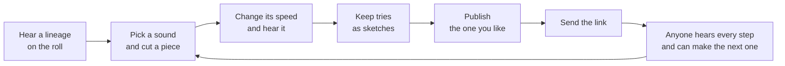

# graft: the user manual

A sound has a past. Hear how this one was made, then make the next step.

This manual is for anyone who opens graft. **The quick guide is one page: read it and you can start.** After it comes the full reference, one table for every screen and button of the live site. How graft is built is in [ARCHITECTURE.md](ARCHITECTURE.md), and a quick look is in [README.md](README.md).

## The quick guide

### What graft is

Every sound here began as one short recording. Someone cut a piece out of it and changed its speed. Someone else did the same to that, and so on. Most sounds lose their past on the way. Graft keeps it.

You open graft and hear a sound, then each step that led to it: where it began, what was cut out, how it was sped up or slowed down. Then you make the next step yourself and send it on.

That is the whole idea: a small public record of how sounds come to be. Who made each one, what it was made from, and a way to hear every step.

### An independent experiment, and a careful one

Graft is a small experiment. It is independent: not affiliated with or endorsed by any product or company. It tries to be careful about what it claims.

- **No accounts.** You do not sign up or log in. Your tries live in your own browser. When you publish, you get a key (more below).
- **It says what it knows and what it does not.** Every fact on a sound's credits is *declared* (a person typed it), *computed* (the system worked it out and could do so again) or *unknown* (nothing establishes it). Titles, names and rights statements are shown as typed, with "not checked" beside them. Graft does not check who made a sound or whether they may share it.
- **Small on purpose.** A flip is one cut and one speed, with no layers or effects, and nothing to export. It is a way to hear a sound's past and add a step, not a studio.
- **A demo on a small budget.** The server sleeps when nobody is around and wakes when someone arrives. If you land while it wakes, the page says so and opens by itself, usually within a minute.

### How it fits together

### Your first few minutes

1. **Open graft.** You see the last stage of a lineage: a title, its credits, and a record. Press **"hear how it was made"**.
2. **Listen.** Short captions tell the story. **"skip"** ends them. Then tap a ring to hear that step.
3. **Press "make a flip"** at the top. You land on a ready-made flip of the stage you were on. Press **"hear it"**.
4. **Change it.** Move a bracket on the waveform, or the speed. The sound follows as you move.
5. **Keep or send.** **"keep as sketch"** keeps the try for you. **"publish this flip"** puts it in the lineage for everyone.

Nothing leaves your device until you publish. If someone sends you a link to a flip, it opens the roll on that flip with the whole lineage behind it: press play, tap the rings, press **"flip this"** to make the next step.

That is enough to start. Everything below is the reference.

---

## The words

| Word | What it means |
|---|---|
| **Flip** | A piece of a sound, played faster or slower. That is all a flip does. |
| **Stage** | One step in a lineage: the first sound, or a flip of the stage before it. |
| **Source** | The sound a lineage began as. Stage 1. |
| **Lineage** | The stages from the source to the newest flip. (The site also says chain.) |
| **Roll** | The home page: a lineage shown like film credits, beside a record. |
| **Sketch** | A try only you can hear, kept in your browser until you publish it. |
| **Key** | What you get when you publish. The only way to change or withdraw that flip later. |
| **Operator** | The person who runs this site. They can hide a sound that breaks the rules and switch publishing off. |

## The roll (the home page)

| What you see | What it does |
|---|---|
| **"stage 4 of 4 · 1/2 · -12.0 st"** | The stage, its speed as a fraction of the stage before it, and its pitch change in semitones. |
| **"make a flip"** | Opens the make page on a ready-made flip of the stage in view. |
| **"theme"** | Cycles system, light, dark. |
| Title, **"play this stage"** | Press the title to hear only that stage. The green line beside it is drawn from the sound's own code: the same sound always draws the same line. |
| **"flip this"** | Opens the make page on the whole stage, with no cut made. |
| **"cut on the record"** | Marks a part on the record to flip only that (below). |
| The credits | One line per fact: who made it, what it was, the licence, each **"declared · not checked"** or **"computed"**. **"more"** scrolls long credits. |
| **"+ rights and details"** | Cut, speed, length, ids, rights, and **"show the code"**, the audio's hash. |
| **"report this sound"** | Opens the report form. |
| **"flips of this stage"** | Flips others made from it, newest first. **"show more"** lists more. **"play these flips as pads"** and **"put the pads away"** show and hide them as pads. |
| **"←"**, **"play"** / **"pause"**, **"→"**, **"perform"** | Play and pause, step to the stage before or after, and turn stages into pads. |
| Corner: **"about"**, **"your flips"**, **"? how it works"**, **"keys"** | The about page (**"play the guide again"** there replays the captions). The list of your flips, shown only in a browser that holds a key. Replays the captions. The keyboard controls, shown once the first play is over. |

**The record.** Each ring is one stage: the outer ring is the source, later flips sit inside, newest innermost. The empty dashed ring is where your next flip goes. The arm across the record is the **needle**; its glowing tip, the **stylus**, follows your pointer, a small number beside it names the stage, and tapping or dragging plays from there. A small dashed circle shows where the sound really is while you hover: where you point and where the sound is are two things on purpose. **Tap a ring** to hear that step.

**Cut on the record.** Press **"cut on the record"**, then drag along a ring to mark a part (on a keyboard, `[` and `]` set its start and end at the stylus). Pick a pitch if you like: **-12, -7, -5, +5, +7, +12** semitones; press one again to unpick it, and the make page opens at its usual speed, a fifth up (150%). **"hear it"** tries it, **"flip this part"** opens the make page with the part cut, **"clear"** removes the mark, **"stop cutting"** leaves the tool. The record is for a rough mark; the make page is for an exact one.

**Perform.** Press **"perform"** and every stage is a pad: touch it, or use the number row (`1` to `9`, `0`, `-`, `=` for stages 1 to 12; the keypad plays 1 to 9). **"cut"**: a new pad cuts off the one sounding. **"overlap"**: pads sound together, up to six. **"stop"** silences. **"rec"** keeps your presses as a phrase (up to sixteen seconds or sixty-four presses); **"play phrase"**, **"loop"**, **"clear"** and **"copy link"** play, repeat, remove and send it (the link holds the presses, no sound; whoever opens it is offered **"play the phrase"**). A pad that cannot play says why: **"no longer here"**, **"held"**, **"not read"** or **"no sound"**. A screen reader keeps the digit keys, so use the pads: they are plain buttons.

## Make a flip

Three steps show at the top: **pick**, **cut and speed**, **share**. On a first visit a guide line sits under them: **"skip"** ends it, **"show me"** scrolls to the control it names. **"? how it works"** shows it again, and on the editor opens a five-step explanation (on the picker it sits folded as **"how graft works"**).

**1. Pick.**

| What you see | What it does |
|---|---|
| **"sounds made for graft"** | Ten sounds: 808 sub, chip arpeggio, power up, saber hum, laser zap, metal clang, house stab, dm9 chord, upright bass, trap hats. **"flip this sound"** picks one. |
| **"flips from the roll"**, **"your flips"** | The flips on the home roll, and the ones you published from this browser. |
| **"record with the microphone"**, **"pick an audio file"** | Your own sound (below), when own sounds are switched on. **"more about recordings"** explains the rules. |

**2. Cut and speed.**

| What you see | What it does |
|---|---|
| **"making stage 2, from 808 sub."**, **"pick another sound"** | Where your flip will sit, and the way back to step 1. |
| **"the cut"**: **"start"**, **"end"** | Drag the brackets to keep a piece. Click one and use the arrow keys: one millisecond a press, ten with shift. A line moves along the waveform as it plays. |
| **"zoom"**, **"-"**, **"+"**, **"fit the cut"** | Look closer to place a bracket exactly. It opens already zoomed in. Scroll or pinch to zoom, shift and scroll to slide. The brackets still hold the whole sound. |
| **"speed"**, the slider, **"-"**, **"+"** | Faster is higher, slower is lower: 150% is a fifth up, 50% an octave down. |
| **"or type a speed"**, **"set"** | Type a number such as 150. It snaps to the nearest speed graft offers, and says so. |
| **"hear it"** / **"pause"**, **"publish this flip"**, **"comes out 0.8 seconds long"** | Play, publish, and the length. These sit in a bar at the foot of the window while you work. Moving a bracket or the speed also starts the sound. |
| **"+ details"** | The hash of what you hear, checked again when you publish. |

**Sketches.** A published flip's sound cannot be changed, so try as many sketches as you like and publish the one you love. They live in this browser only: closing the tab keeps them, a private window loses them.

| What you see | What it does |
|---|---|
| **"name of this try"**, **"keep as sketch"**, **"add a note"** | Keep the cut and speed as a sketch. The name is optional (it is named from the speed). A note, up to 140 characters, goes with the flip if you publish. |
| **"your sketches"** | The list. A box on each, **"publish this one"**, ticks it for **"publish these"**. |
| **"open"**, **"keep as another try"**, **"back to sketch"** | Load a sketch, save a changed version as a new one, and return. |
| **"go on from this"**, **"rename"**, **"edit the note"**, **"discard"** | Build on a sketch; change its name or note; delete it (**"yes, discard"** confirms). |
| **A** and **B** | Pick two sketches. **"play A then B"**, **"play one"**, **"stop"**, **"clear A and B"** compare them. |
| **"put on the bank"** | Puts a sketch on a pad, up to twelve. It plays like perform. **"number keys: off"** turns the number keys on, so a digit typed anywhere else never makes a sound. **"move earlier"**, **"move later"**, **"remove from the bank"** reorder. A phrase on the bank lasts for this visit and cannot be sent as a link. |
| **"publish these"** | Publishes the ticked sketches in order, up to twelve a press, after you add **"your name"**. **"stop after this one"** pauses, **"continue"** carries on, and what is published stays published. Results show **"show key"**, **"hide key"**, **"copy all keys"** and **"keep these keys in this browser"**. |
| **"move my sketches"** | **"copy my sketchbook link"** (anyone with it can read your sketches; it carries no keys), **"save my sketches to a file"** (plain text, no keys, up to 64 kilobytes), **"add sketches from a file"**. A sketchbook link opened elsewhere asks **"add them"** or **"not now"**. |

**3. Share.** Press **"publish this flip"**. What you publish is public: anyone with the link can hear it and flip it. Fill in **"title"** (up to 60 characters) and **"your name"** (up to 32), both shown as typed; the name is not a handle and links nowhere. **"a note"** is optional (up to 140 characters, shown under the title). **"publish"** stays disabled until title and name are filled; **"keep editing"** goes back. Links and @handles are removed from what you type, and graft tells you. If the network fails, graft retries the same request, so nothing is made twice.

When it is published you see the link to your flip, and a line saying what it is for: send it to anyone and they hear every step behind your flip and can make the next one. **"your ticket for this flip"** is your key, shown once; **"copy the key"** copies it. It is not a login and not who you are, and losing it only means this flip's settings cannot be changed. **"keep this key in this browser"** is ticked by default, so the flip is listed under "your flips". **"flip this next"** makes the next stage from the one you published. **"open it in a new tab"**, **"copy the link"** and **"manage this publication"** do what they say. The sound is now fixed: to change it, flip it again. Only its note can change.

**Your own sound.** **"record with the microphone"** asks permission and stops at 30 seconds. **"pick an audio file"** reads up to 30 minutes (150 megabytes); **"pick the part to keep"** lets you place the brackets and **"use this part"** confirms. A source is at most 30 seconds. It stays on your device until you press **"publish your sound"**, say what you are saying (**"i made this sound"** or **"i have the right to share it"**) and confirm. It is printed as declared and graft cannot check it, so publish only what you made or may share. It becomes stage 1, and flips of it are stage 2 onward.

## Your flips and managing them

**"your flips"** lists what you published from this browser, by lineage, and whether each is open, closed, withdrawn or not found. There is no account, so the list is only the keys kept in this browser: wipe your browser's data and it goes too. Copy keys somewhere safe if they matter.

| Button | What it does |
|---|---|
| **"open"**, **"manage"** | The flip in its lineage, or its manage page. |
| **"forget"** | Removes the key from this browser (**"yes, forget it"** confirms). It does not withdraw the flip. |
| **"play your flips as pads"** | Your flips on pads, source first in each lineage. |

On a manage page, use **"use the key kept in this browser"** or paste a key into **"manage key"**. Then, for that one flip: **"save the note"** or **"remove the note"**; **"close it to new flips"** (no new flips of this stage; the ones made stay) and **"open it to new flips again"**; **"withdraw it"** (then **"yes, withdraw it"**), which hides the sound and stops serving its audio. A withdrawn flip stays in every lineage as "no longer here", and flips built on it keep playing. Only the operator can undo a withdrawal. **"forget the key kept in this browser"** removes the saved key.

## Report a sound

Anyone can report a sound, without an account. Press **"report this sound"**, pick **what is wrong** (the right to share it is in doubt, it holds a private conversation, it is harmful, it is spam, or something else), add a note of up to 500 characters if you like, and press **"send the report"**. No name or contact details are asked for or kept, so you will not hear back. The operator reads it. A sound that breaks the rules, or whose right to share is in doubt, is hidden and stays in its lineage as "no longer here", and flips built on it are held while it is looked at. A copy someone already downloaded cannot be recalled.

## Keys on the keyboard

**"keys"** lists them all. The short version:

| Where | Keys |
|---|---|
| The record | `←` `→` move the stylus a tenth of a second. `↑` `↓` change stage. `Home` `End` jump to either end. `Enter` or `Space` plays from the stylus. `[` `]` set a marked part. `Esc` leaves marking or skips the captions. |
| Perform | `1` to `9`, `0`, `-`, `=` play stages 1 to 12. `Esc` silences, then leaves. |
| A bracket | `←` `→` move it one millisecond, with `Shift` ten. `Home` `End` send it to either end of the sound. |
| The speed | `←` `→` change the speed, and the sound with it. |

## Limits

| What | Limit |
|---|---|
| A source / a cut / a flip | 30 seconds / 10 milliseconds to 30 seconds / 10 milliseconds to 60 seconds |
| Speed | 25% to 400% |
| A lineage | 12 stages (the editor says how many still fit) |
| Sketches / bank pads / one "publish these" press | 40 / 12 / 12 |
| A phrase | 16 seconds or 64 presses |
| A recording you load | 30 minutes, 150 megabytes |
| Title, name, note | 60, 32 and 140 characters |

## Privacy, in plain words

No accounts, and no IP address stored in graft's own records (the hosts it runs on must handle addresses to deliver traffic, as any host does). A visit gets an anonymous session id kept in memory only, and if your browser sends global privacy control or do not track, graft sends no events at all. Your browser keeps only your theme, your place in the first-visit guide, the keys of flips you publish, and your sketches, which never leave it unless you publish them. The about page lists every claim and how it is tested.

## When something goes wrong

| What you see | What it means |
|---|---|
| **"waking up."** | The server was asleep. It needs about a minute and the page opens by itself. |
| **"the sounds could not be loaded. reload to try again."**, **"you look to be offline."** | Reload, or wait: graft checks again when you are back. |
| **"you have published a lot in a short time"**, **"everyone together has published as much as is allowed for now"** | A limit that keeps a small demo small. Nothing is lost. Try again after the time it gives. |
| **"publishing is switched off for now"** | The operator closed publishing. Your flip stays in the editor. |
| **"the maker of this stage has closed it to new flips"**, **"this chain is as long as chains can be"** | Flip another stage. A lineage holds 12 stages. |
| **"no longer here, but its credit is"**, **"held"** | A sound was withdrawn or hidden, or a stage it was built on is being looked at for rights. Its place in the lineage stays. |
| A pad is quiet on an iPhone | The ring switch is set to silent. Turn it off, raise the volume, press again. |
| Sketches or keys are gone | You used a private window or wiped your browser's data. They live only in your browser. |

Graft is a small thought about sound and credit, and it is still being made. If something here is wrong or unclear, that is the manual's fault, not yours.
