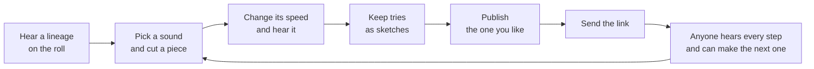

# graft: the user manual

A sound has a past. Hear how this one was made, then make the next step.

This manual is for anyone who opens graft: what it is, why it exists, and what every button does. It describes the live site. How it is built is in [ARCHITECTURE.md](ARCHITECTURE.md), and a quick look is in [README.md](README.md).

## What graft is

Every sound here began as one short recording. Someone cut a piece out of it and changed its speed. Someone else did the same to that, and so on. Most sounds lose their past on the way. Graft keeps it.

You open graft and hear a sound, then each step that led to it: where it began, what was cut out, how it was sped up or slowed down. Then you make the next step yourself and send it on.

That is the whole idea: a small public record of how sounds come to be. Who made each one, what it was made from, and a way to hear every step.

## An independent experiment, and a careful one

Graft is a small experiment. It is independent: not affiliated with or endorsed by any product or company. It tries to be careful about what it claims.

- **No accounts.** You do not sign up or log in. Your tries live in your own browser. When you publish, you get a key (more on that below).
- **It says what it knows and what it does not.** Every fact on a sound's credits is labelled *declared* (a person typed it), *computed* (the system worked it out and could do so again) or *unknown* (nothing establishes it). Titles, names and rights statements are shown exactly as typed, with "not checked" beside them. Graft does not check who made a sound or whether they may share it.
- **Small on purpose.** A flip is one cut and one speed. There are no layers, no effects, no exporting. It is a way to hear a sound's past and add a step, not a studio.
- **A demo on a small budget.** The server sleeps when nobody is around and wakes when someone arrives. If you land on a page while it wakes, the page says so and opens by itself, usually within a minute.

## The words

| Word | What it means |
|---|---|
| **Flip** | A piece of a sound, played faster or slower. That is all a flip does. |
| **Stage** | One step in a lineage: the first sound, or a flip of the stage before it. |
| **Source** | The sound a lineage began as. Stage 1. |
| **Lineage** | The stages from the source to the newest flip. (The site also calls it a chain.) Each stage remembers what it came from. |
| **Roll** | The home page. It shows a lineage like film credits, one stage after another. |
| **Record** | The round picture beside the roll. Each ring is one stage. |
| **Sketch** | A try that only you can hear. Kept in your browser until you publish it. |
| **Key** | What you get when you publish. It is the only way to change or withdraw that flip later. |
| **Operator** | The person who runs this site. They can hide a sound that breaks the rules and switch publishing off. |

## How it fits together

## Your first few minutes

1. **Open graft.** You see the last stage of a lineage: a title, its credits, and a record. Press **"hear how it was made"**.
2. **Listen.** Short captions tell the story as it plays: where the sound began, then each cut and speed change. Then tap a ring to hear that step, or drag the needle to hear any moment.
3. **Press "make a flip"** at the top. You land on a ready-made flip of the stage you were on. Press **"hear it"**.
4. **Change it.** Move a bracket on the waveform, or move the speed. The sound follows as you move.
5. **Keep or send.** **"keep as sketch"** keeps the try for you. **"publish this flip"** puts it in the lineage for everyone.

Nothing leaves your device until you publish.

## If someone sends you a link

A link to a flip opens the roll on that flip, with the whole lineage behind it. Press play, tap the rings, and press **"flip this"** to make the next step. A link can also carry a **phrase** (pads someone played; you are offered it and it plays when you press **"play the phrase"**) or a **sketchbook** (someone's sketches; the make page asks **"add them"** or **"not now"**). Links carry no sound and no keys.

## The roll (the home page)

| What you see | What it does |
|---|---|
| **"graft"** (top left) and the line under it | The name, and the idea in one sentence. |
| **"stage 4 of 4 · 1/2 · -12.0 st"** (top middle) | Which stage you are on, how fast it was played (as a fraction of the stage before it), and the change in pitch in semitones. |
| **"make a flip"** | Opens the make page on a ready-made flip of the stage in view, so one tap on "hear it" gives sound. |
| **"theme"** | Cycles system, then light, then dark. Your choice is remembered. |
| The title slab and **"play this stage"** | Press the title to hear only that stage. |
| **"flip this"** | Opens the make page on the whole stage, with no cut made. |
| **"cut on the record"** | Lets you mark a part on the record and flip only that (see below). |
| The credits | One line per fact: who made it, what it was, the licence. Each shows **"declared · not checked"** or **"computed"**. |
| **"+ rights and details"** | The cut, the speed, the length, the ids, the audio hash, and what is said about rights. |
| **"more"** | Scrolls the credits when they are longer than the screen. |
| **"report this sound"** | Opens the report form (see "Report a sound"). |
| **"flips of this stage"** | The flips other people made from this stage, newest first. **"play these flips as pads"** puts them on pads. |
| **"←"**, **"play"** or **"pause"**, **"→"** | Play and pause, and step to the stage before or after. On a first visit the main button reads "hear how it was made". |
| **"perform"** | Turns the stages into pads you can play (see "Perform"). |
| **"about"** | The about page. |
| **"your flips"** | Shown only in a browser that holds a key. Opens the list of flips you published. |
| **"? how it works"** | Plays the guided first play again from the start. |
| **"keys"** | Lists every keyboard control for the page. It appears once the first play is done. |

### The record

Each ring is one stage. The outer ring is the source, the first sound. The inner rings are the later flips, newest in the middle. The number beside a ring is its stage.

- **Tap a ring** to hear that step.
- **Drag the needle** to hear any moment. The needle follows your pointer.
- The **dashed ring** shows where the sound is right now. These are two different things on purpose: where you point, and where the sound is.
- With a keyboard, focus the record. Left and right move the needle a tenth of a second. Up and down move to the stage outside or inside. Home and end jump to the start or end of the stage. Enter or space plays from the needle.

### Cut on the record

Use this when you like one part of a stage and want to flip only that.

1. Press **"cut on the record"**.
2. Drag along a ring to mark the part you want. On a keyboard, press `[` and `]` on the record to set where it starts and ends.
3. Pick a pitch if you like: **-12, -7, -5, +5, +7, +12** semitones. Press one again to unpick it. The make page then opens at its usual speed, a fifth up (150%), and you set the speed there.
4. Press **"hear it"** to try it, then **"flip this part"**. The make page opens with your part already cut.
5. **"clear"** removes the mark. **"stop cutting"** leaves the tool.

The record is for a rough mark. The make page is for an exact one.

### Perform

Press **"perform"** and every stage becomes a pad.

- **Number keys:** `1` to `9`, `0`, `-` and `=` play stages 1 to 12, by where the key sits on the number row. The keypad plays 1 to 9. Or touch the pads.
- **"cut"** (the default): a new pad cuts off the one still sounding. **"overlap"**: pads keep sounding together, up to six. **"stop"** silences everything.
- **"rec"** keeps the pads you press, up to sixteen seconds or sixty-four presses, as a phrase. Then **"play phrase"** runs it once, **"loop"** repeats it, **"clear"** removes it, and **"copy link"** sends it. The link holds the presses and no sound. Whoever opens it can play your phrase on the same stages.
- **Escape** ends a recording, or silences the sound. A second press leaves perform.
- A screen reader keeps the digit keys for itself, so use the pads. They are plain buttons.

A stage that cannot play says why on its pad: **"no longer here"**, **"held"**, **"not read"** or **"no sound"**.

## Make a flip

The make page has three steps, shown at the top: **pick**, **cut and speed**, **share**. A short guide line appears under them on a first visit. **"skip"** ends it and **"show me"** scrolls to the control it names. **"? how it works"** shows the guide again, and on the editor it also opens a five-step explanation of graft. On the picker the same explanation sits folded under the guide line, as **"how graft works"**.

### 1. Pick a sound

| What you see | What it does |
|---|---|
| **"record with the microphone"** | Records your own sound (see "Your own sound"). Shown when own sounds are switched on. |
| **"pick an audio file"** | Reads an audio file from your device. |
| **"more about recordings"** | What happens to a recording, and the rule to publish only what you may share. |
| **"sounds made for graft"** | Ten sounds made for graft: 808 sub, chip arpeggio, power up, saber hum, laser zap, metal clang, house stab, dm9 chord, upright bass and trap hats. Press **"flip this sound"** on one. |
| **"flips from the roll"** | The flips on the home roll, so you can build on them. |
| **"your flips"** | Flips you published from this browser, once you have some. |

### 2. Cut and speed

| What you see | What it does |
|---|---|
| The title and **"making stage 2, from 808 sub."** | The sound you are working on, and where your flip will sit in the lineage. |
| **"pick another sound"** | Goes back to step 1. |
| **"the cut"**: the waveform with **"start"** and **"end"** brackets | Drag the brackets to keep a piece. Click a bracket and use the arrow keys: one millisecond a press, ten with shift. The line that moves along the waveform is where the sound is playing. |
| **"zoom"**, **"-"**, **"+"**, **"fit the cut"** | Look closer to place a bracket exactly. Zoom opens already zoomed in. Scroll or pinch to zoom around the pointer, hold shift and scroll to slide. The brackets still hold the whole sound. **"fit the cut"** zooms back to your cut. |
| **"speed"**: the big percentage, the slider, **"-"** and **"+"** | Faster is higher, slower is lower. 150% is a fifth up, 50% is an octave down. Speeds run from 25% to 400%. |
| **"or type a speed"** and **"set"** | Type a number such as 150. If it falls between two speeds graft offers, it snaps to the nearest and says so. |
| **"hear it"** or **"pause"** | Plays your flip. Moving a bracket or the speed also starts it, so you hear the change as you make it. |
| **"publish this flip"** | Opens step 3. |
| **"comes out 0.8 seconds long"** | How long your flip is. These three sit in a bar at the foot of the window while you work, so they are never out of reach. |
| **"+ details"** | The hash of what you hear, a code worked out from the sound. It is checked again when you publish. |

### Sketches

A sketch is a try only you can hear. A published flip is public and its sound cannot be changed, so try as many as you like and publish the one you love. Sketches live in this browser only: closing the tab keeps them, a private window loses them when it closes.

| What you see | What it does |
|---|---|
| **"name of this try"** | Optional. Left empty, it is named from the speed. |
| **"keep as sketch"** | Keeps your current cut and speed as a sketch. |
| **"add a note"** | A line to remember it by, up to 140 characters. It goes with the flip if you publish. |
| **"your sketches"** | The list. Each sketch shows what it is cut from, its speed, its length, and its note. |
| **"publish this one"** (a box on each sketch) | Ticks it for **"publish these"**. |
| **"open"** | Loads the sketch back into the editor. **"keep as another try"** then keeps a changed version as a new sketch, and **"back to sketch"** returns. |
| **"go on from this"** | Starts a new try that builds on the sketch. |
| **"rename"**, **"edit the note"**, **"discard"** | Change the name or note, or delete it (it asks **"yes, discard"** first). |

**Compare two.** Press **A** on one sketch and **B** on another. Then **"play A then B"** plays them in order, **"play one"** plays one, **"stop"** stops, and **"clear A and B"** resets.

**The bank.** **"put on the bank"** puts a sketch on a pad. The bank holds up to twelve and plays like perform: pads, **"cut"** and **"overlap"**, **"rec"** for a phrase. The **"number keys: off"** button turns the number keys on (it then reads "number keys: on"), so a digit typed anywhere else never makes a sound. **"move earlier"**, **"move later"** and **"remove from the bank"** change the order. A phrase on the bank lasts for this visit and cannot be sent as a link, because sketches are private.

**Publish several at once.** Tick **"publish this one"** on the sketches you want, add **"your name"**, and press **"publish these"**. They go out in order, up to twelve a press, and their links and keys end up on one screen. **"stop after this one"** pauses and **"continue"** carries on. If it stops, what is published stays published and the rest wait in your browser. **"copy all keys"** copies the keys as plain text. **"keep these keys in this browser"** lists the flips under "your flips".

**Move your sketches.** Under **"move my sketches"**: **"copy my sketchbook link"** (the link carries your sketches, anyone you send it to can read them, and it carries no keys), **"save my sketches to a file"** (plain text, no keys, up to 64 kilobytes) and **"add sketches from a file"**. Open a sketchbook link on another device and it asks **"add them"**, or **"not now"**.

### 3. Share (publish)

Press **"publish this flip"**. Be sure first: what you publish is public. Anyone with the link can hear it and flip it.

| What you see | What it does |
|---|---|
| **"title"** | Up to 60 characters, shown as typed. |
| **"your name"** | Up to 32 characters, shown as typed. It is not a handle and links nowhere. |
| **"a note"** | Optional, up to 140 characters, shown under the title. You can change it later with your key. |
| **"publish"** | Sends it. It stays disabled until the title and name are filled in. |
| **"keep editing"** | Goes back without publishing. |

Links and @handles are removed from titles, names and notes, and graft tells you when it does. If the network fails, graft tries again with the same request, so nothing is made twice.

**When it is published** you see:

- **The link to your flip**, and a line saying what it is for: send it to anyone, and they hear every step behind your flip and can make the next one.
- **"your ticket for this flip"**: your key. It is shown once. **"copy the key"** copies it. It is not a login and not who you are. If you lose it, the only loss is that this flip's settings cannot be changed.
- **"keep this key in this browser"**: ticked by default, so the flip is listed under "your flips". Untick it to forget the key now.
- **"flip this next"**: makes the next stage from the one you published, in the same tab.
- **"open it in a new tab"**, **"copy the link"**, **"manage this publication"**, **"your flips"**.

A published flip's sound is fixed. To change it, flip it again: that makes a new stage after it and leaves this one as it was. Only the note can change.

### Your own sound

When own sounds are switched on, you can start from a recording of your own.

- **"record with the microphone"** asks your browser for permission first. It stops by itself at 30 seconds.
- **"pick an audio file"** reads a file of up to 30 minutes (up to 150 megabytes). A thirty minute recording fits as mp3 or m4a, not as wav. You then see **"pick the part to keep"**: move along the recording to find the moment, place the brackets, and press **"use this part"**. A source is at most 30 seconds.
- Your sound stays on your device until you publish it. Then its own flips can follow.
- To publish it, press **"publish your sound"** and say what you are saying: **"i made this sound"** or **"i have the right to share it"**, and confirm. This is printed with your sound as declared. Graft cannot check it. Publish only sounds you made or may share.
- Your published sound becomes stage 1, and the flip you make from it is stage 2.

## Your flips

Open **"your flips"** (in the corner, once this browser holds a key). It lists what you published, grouped by lineage: its stage, what it was made from, and whether it is open to new flips, closed, withdrawn, or not found.

| Button | What it does |
|---|---|
| **"open"** | Opens the flip in its lineage. |
| **"manage"** | Opens its manage page. |
| **"forget"** | Removes the key from this browser (it asks **"yes, forget it"**). It does not withdraw the flip. |
| **"play your flips as pads"** | Your flips on pads, source first in each lineage. |

Graft has no account, so this list is only the keys kept in this browser. Clear your browser's data and the list goes with it. Copy your keys somewhere safe if they matter to you.

## Manage a flip

The manage page opens from the published screen or from "your flips". Use **"use the key kept in this browser"**, or paste the key into **"manage key"**. Then, for that one flip and nothing else:

- **"the note"**: **"save the note"** or **"remove the note"**, whenever you like. The sound stays exactly as it is.
- **"close it to new flips"** stops anyone making new flips of this stage. Flips already made stay. **"open it to new flips again"** undoes it.
- **"withdraw it"** (then **"yes, withdraw it"**) hides the sound and stops serving its audio. Its credit stays in every lineage as "no longer here", and flips built on it keep playing. You cannot undo it. Only the operator can.

## Report a sound

Anyone can report a sound, without an account. Press **"report this sound"** on the roll, pick **what is wrong** (the right to share it is in doubt, it holds a private conversation, it is harmful, it is spam, or something else), add a note of up to 500 characters if you want, and press **"send the report"**. No account, name or contact details are asked for or kept. You will not hear back, because graft keeps no way to reach you.

The operator reads it. If the sound breaks the rules, or the right to share it is in doubt, it is hidden and stays in its lineage as "no longer here". The flips built on it are held while it is looked at. Addresses already issued for its audio expire on their own. A copy that someone already downloaded cannot be recalled.

## Keys on the keyboard

Press **"keys"** on the roll or the make page for the full list. The short version:

| Where | Keys |
|---|---|
| The record | `←` `→` move the needle. `↑` `↓` change stage. `Home` `End` jump. `Enter` or `Space` plays. `[` and `]` set a marked part. `Esc` leaves marking or skips the captions. |
| Perform | `1` to `9`, `0`, `-`, `=` play stages 1 to 12. `Esc` silences, then leaves. |
| A bracket | `←` `→` move it one millisecond, with `Shift` ten. `Home` `End` send it to the ends of the sound. |
| The speed | `←` `→` change the speed, and the sound with it. |

## Limits

| What | Limit |
|---|---|
| A source (a sound you start from) | 30 seconds |
| A cut | 10 milliseconds to 30 seconds |
| A flip's length | 10 milliseconds to 60 seconds |
| Speed | 25% to 400% |
| A lineage | 12 stages |
| Sketches in your browser | 40 |
| Pads on the bank | 12 |
| Sketches in one "publish these" press | 12 |
| A phrase | 16 seconds or 64 presses |
| A recording you load | 30 minutes, 150 megabytes |
| Title, name, note | 60, 32 and 140 characters |

The editor tells you how many stages still fit: for example "10 more stages fit after this one."

## Privacy, in plain words

- A visit gets an anonymous session id that lives in memory only. It is never written to your browser and is gone when the page closes.
- If your browser sends global privacy control or do not track, graft sends no events at all and does not load its error tracker.
- Opening graft may wake its server if it was asleep. Your browser asks graft's own site, which sends one short call with nothing about you in it.
- Graft stores no IP address in its own records. The hosts it runs on have to process addresses to deliver traffic, as any host does.
- Where error tracking is on, it runs without IP addresses, without session replay and with a scrubber.
- Your browser holds only: your light or dark choice, a note of how far you got in the first-visit guide, the keys of flips you publish from it, and your sketches. Sketches never leave your browser unless you publish them. You can untick "keep this key", forget a key on "your flips", or discard any sketch.

## When something goes wrong

| What you see | What it means |
|---|---|
| **"waking up."** | The server was asleep. It needs about a minute. The page opens by itself. |
| **"the sounds could not be loaded. reload to try again."** | The sounds did not arrive. Reload. |
| **"you look to be offline."** | Graft checks again when you are back. |
| **"you have published a lot in a short time"** or **"everyone together has published as much as is allowed for now"** | A limit, so a small demo stays small. Nothing you made is lost. Try again after the time it gives. |
| **"publishing is switched off for now"** | The operator closed publishing. Your flip is still in the editor. |
| **"the maker of this stage has closed it to new flips"** | That stage's key holder closed it. Flip another stage. |
| **"this chain is as long as chains can be"** | A lineage holds 12 stages. |
| **"no longer here, but its credit is"** | A sound was withdrawn or hidden. Its place in the lineage stays. |
| **"held"** | A stage it was built on is being looked at for rights. It plays again when that is settled. |
| A pad stays quiet on an iPhone | The ring switch is set to silent. Turn it off, turn the volume up, and press again. |
| Your sketches or keys are gone | You used a private window or wiped your browser's data. They live only in your browser. |

## What to try

- Play a lineage from the top, then tap each ring.
- Mark a part on the record and flip only that.
- Make three versions of one sound, keep them as sketches, and play them side by side on pads.
- Publish one, send the link to a friend, and see what they make next.

Graft is a small thought about sound and credit, and it is still being made. If something here is wrong or unclear, that is the manual's fault, not yours.
