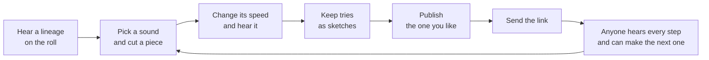

# graft: the user manual

A sound has a past. Hear how this one was made, then make the next step.

This manual is for anyone who opens graft: what it is, why it exists, and what every button does. It describes the live site. How it is built is in [ARCHITECTURE.md](ARCHITECTURE.md), and a quick look is in [README.md](README.md).

**Short on time?** Read the next five sections (about three minutes): the idea, the words, the loop, your first few minutes, and what to do with a link. Everything after that is a reference: one table for each screen, to dip into when you wonder what a button does.

## What graft is

Every sound here began as one short recording. Someone cut a piece out of it and changed its speed. Someone else did the same to that, and so on. Most sounds lose their past on the way. Graft keeps it.

You open graft and hear a sound, then each step that led to it: where it began, what was cut out, how it was sped up or slowed down. Then you make the next step yourself and send it on.

That is the whole idea: a small public record of how sounds come to be. Who made each one, what it was made from, and a way to hear every step.

## An independent experiment, and a careful one

Graft is a small experiment. It is independent: not affiliated with or endorsed by any product or company. It tries to be careful about what it claims.

- **No accounts.** You do not sign up or log in. Your tries live in your own browser. When you publish, you get a key (more below).
- **It says what it knows and what it does not.** Every fact on a sound's credits is labelled *declared* (a person typed it), *computed* (the system worked it out and could do so again) or *unknown* (nothing establishes it). Titles, names and rights statements are shown as typed, with "not checked" beside them. Graft does not check who made a sound or whether they may share it.
- **Small on purpose.** A flip is one cut and one speed, with no layers or effects, and nothing to export. Graft is a way to hear a sound's past and add a step, not a studio.
- **A demo on a small budget.** The server sleeps when nobody is around and wakes when someone arrives. If you land while it wakes, the page says so and opens by itself, usually within a minute.

## The words

| Word | What it means |
|---|---|
| **Flip** | A piece of a sound, played faster or slower. That is all a flip does. |
| **Stage** | One step in a lineage: the first sound, or a flip of the stage before it. |
| **Source** | The sound a lineage began as. Stage 1. |
| **Lineage** | The stages from the source to the newest flip. (The site also says chain.) Each stage remembers what it came from. |
| **Roll** | The home page: a lineage shown like film credits, beside a record. |
| **Sketch** | A try only you can hear, kept in your browser until you publish it. |
| **Key** | What you get when you publish. The only way to change or withdraw that flip later. |
| **Operator** | The person who runs this site. They can hide a sound that breaks the rules and switch publishing off. |

## How it fits together

## Your first few minutes

1. **Open graft.** You see the last stage of a lineage: a title, its credits, and a record. Press **"hear how it was made"**.
2. **Listen.** Short captions tell the story: where the sound began, then each cut and speed change. **"skip"** ends them. Then tap a ring to hear that step.
3. **Press "make a flip"** at the top. You land on a ready-made flip of the stage you were on. Press **"hear it"**.
4. **Change it.** Move a bracket on the waveform, or the speed. The sound follows as you move.
5. **Keep or send.** **"keep as sketch"** keeps the try for you. **"publish this flip"** puts it in the lineage for everyone.

Nothing leaves your device until you publish. Then try three versions of one sound, play them side by side on pads, and send the one you like to a friend.

## If someone sends you a link

A link to a flip opens the roll on that flip, with the whole lineage behind it. Press play, tap the rings, and press **"flip this"** to make the next step. A link can also carry a **phrase** (pads someone played: you are offered it, and it plays when you press **"play the phrase"**) or a **sketchbook** (someone's sketches: the make page asks **"add them"** or **"not now"**). Links carry no sound and no keys.

## The roll (the home page)

| What you see | What it does |
|---|---|
| **"stage 4 of 4 · 1/2 · -12.0 st"** (top middle) | The stage you are on, its speed as a fraction of the stage before it, and its pitch change in semitones. |
| **"make a flip"** | Opens the make page on a ready-made flip of the stage in view, so one tap on "hear it" gives sound. |
| **"theme"** | Cycles system, light, dark. Remembered. |
| The title and **"play this stage"** | Press the title to hear only that stage. The small green line beside it is drawn from the sound's own code: the same sound always draws the same line. |
| **"flip this"** | Opens the make page on the whole stage, with no cut made. |
| **"cut on the record"** | Marks a part on the record to flip only that (below). |
| The credits | One line per fact: who made it, what it was, the licence. Each is **"declared · not checked"** or **"computed"**. **"more"** scrolls them when they are longer than the screen. |
| **"+ rights and details"** | The cut, speed, length, ids, what is said about rights, and **"show the code"**, the audio's hash. |
| **"report this sound"** | Opens the report form. |
| **"flips of this stage"** | Flips others made from this stage, newest first. **"show more"** lists more. **"play these flips as pads"** puts them on pads, and **"put the pads away"** hides them. |
| **"←"**, **"play"** / **"pause"**, **"→"** | Play and pause, and step to the stage before or after. **"perform"** turns the stages into pads (below). |
| Bottom corner: **"about"**, **"your flips"**, **"? how it works"**, **"keys"** | **"about"** opens the about page, where **"play the guide again"** replays the first-visit captions. **"your flips"** shows only in a browser that holds a key. **"? how it works"** also replays the captions. **"keys"** lists the keyboard controls and appears once the first play is over. |

### The record

Each ring is one stage: the outer ring is the source, and later flips sit inside it, newest innermost. The empty dashed ring inside them is where your next flip would go.

- The arm that crosses the record is the **needle**. Its glowing tip, the **stylus**, follows your pointer over the record. Tap or drag to play from there. A small number beside it names the stage you are on.
- A small dashed circle shows where the sound really is while you hover. Where you point and where the sound is are two things on purpose.
- **Tap a ring** to hear that step.

### Cut on the record

1. Press **"cut on the record"**.
2. Drag along a ring to mark the part you want. On a keyboard, `[` and `]` set its start and end at the stylus.
3. Pick a pitch if you like: **-12, -7, -5, +5, +7, +12** semitones. Press one again to unpick it, and the make page opens at its usual speed, a fifth up (150%).
4. **"hear it"** tries it. **"flip this part"** opens the make page with your part already cut. **"clear"** removes the mark. **"stop cutting"** leaves the tool.

The record is for a rough mark. The make page is for an exact one.

### Perform

Press **"perform"** and every stage becomes a pad. Touch a pad, or press the number row: `1` to `9`, `0`, `-`, `=` play stages 1 to 12 (the keypad plays 1 to 9).

- **"cut"**: a new pad cuts off the one still sounding. **"overlap"**: pads keep sounding together, up to six. **"stop"** silences everything.
- **"rec"** keeps the pads you press, up to sixteen seconds or sixty-four presses, as a phrase. **"play phrase"** runs it once, **"loop"** repeats it, **"clear"** removes it, **"copy link"** sends it (the link holds the presses and no sound).
- A pad that cannot play says why: **"no longer here"**, **"held"**, **"not read"** or **"no sound"**.
- A screen reader keeps the digit keys for itself, so use the pads: they are plain buttons.

## Make a flip

Three steps show at the top: **pick**, **cut and speed**, **share**. On a first visit a short guide line sits under them. **"skip"** ends it and **"show me"** scrolls to the control it names. **"? how it works"** shows the guide again, and on the editor it opens a five-step explanation of graft. On the picker the same explanation sits folded as **"how graft works"**.

### 1. Pick a sound

| What you see | What it does |
|---|---|
| **"record with the microphone"** and **"pick an audio file"** | Start from a sound of your own (see "Your own sound"). Shown when own sounds are switched on. **"more about recordings"** explains the rules. |
| **"sounds made for graft"** | Ten sounds: 808 sub, chip arpeggio, power up, saber hum, laser zap, metal clang, house stab, dm9 chord, upright bass and trap hats. **"flip this sound"** picks one. |
| **"flips from the roll"** | The flips on the home roll, to build on. |
| **"your flips"** | Flips you published from this browser. |

### 2. Cut and speed

| What you see | What it does |
|---|---|
| **"making stage 2, from 808 sub."** | The sound you are on and where your flip will sit. **"pick another sound"** goes back to step 1. |
| **"the cut"**: the waveform, **"start"** and **"end"** | Drag the brackets to keep a piece. A line moves along the waveform as it plays. |
| **"zoom"**, **"-"**, **"+"**, **"fit the cut"** | Look closer to place a bracket exactly. Zoom opens already zoomed in. Scroll or pinch to zoom, shift and scroll to slide. The brackets still hold the whole sound. |
| **"speed"**: the big percentage, the slider, **"-"**, **"+"** | Faster is higher, slower is lower. 150% is a fifth up, 50% an octave down. |
| **"or type a speed"**, **"set"** | Type a number such as 150. A number between two speeds graft offers snaps to the nearest, and says so. |
| **"hear it"** / **"pause"** | Plays your flip. Moving a bracket or the speed starts it too, so you hear changes as you make them. |
| **"publish this flip"** | Opens step 3. |
| **"comes out 0.8 seconds long"** | The length of your flip. These three sit in a bar at the foot of the window while you work. |
| **"+ details"** | The hash of what you hear: a code worked out from the sound, checked again when you publish. |

### Sketches

A published flip is public and its sound cannot be changed, so try as many sketches as you like and publish the one you love. They live in this browser only: closing the tab keeps them, a private window loses them.

| What you see | What it does |
|---|---|
| **"name of this try"** | Optional. Left empty, it is named from the speed. |
| **"keep as sketch"**, **"add a note"** | Keeps the cut and speed. A note is a line to remember it by, up to 140 characters, sent with the flip if you publish. |
| **"your sketches"** | The list: what each is cut from, its speed, length and note. A box on each, **"publish this one"**, ticks it for **"publish these"**. |
| **"open"** | Loads a sketch into the editor. **"keep as another try"** saves a changed version as a new sketch, and **"back to sketch"** returns. |
| **"go on from this"** | Starts a new try that builds on the sketch. |
| **"rename"**, **"edit the note"**, **"discard"** | Change the name or note, or delete it (**"yes, discard"** confirms). |

- **Compare two.** Press **A** on one sketch and **B** on another. **"play A then B"** plays both, **"play one"** plays one, **"stop"** stops, **"clear A and B"** resets.
- **The bank.** **"put on the bank"** puts a sketch on a pad, up to twelve. It plays like perform. The **"number keys: off"** button turns the number keys on, so a digit typed anywhere else never makes a sound. **"move earlier"**, **"move later"** and **"remove from the bank"** change the order. A phrase on the bank lasts for this visit and cannot be sent as a link.
- **Publish several at once.** Tick sketches, add **"your name"**, press **"publish these"**. They go out in order, up to twelve a press. **"stop after this one"** pauses, **"continue"** carries on, and what is published stays published. The results show a link and a key for each: **"show key"** and **"hide key"**, **"copy all keys"**, and **"keep these keys in this browser"**.
- **Move your sketches.** Under **"move my sketches"**: **"copy my sketchbook link"** (anyone you send it to can read your sketches; it carries no keys), **"save my sketches to a file"** (plain text, up to 64 kilobytes, no keys) and **"add sketches from a file"**.

### 3. Share (publish)

Press **"publish this flip"**. What you publish is public: anyone with the link can hear it and flip it.

| What you see | What it does |
|---|---|
| **"title"**, **"your name"** | Required. Up to 60 and 32 characters, shown as typed. The name is not a handle and links nowhere. |
| **"a note"** | Optional, up to 140 characters, shown under the title. |
| **"publish"** / **"keep editing"** | Sends it, or goes back. Publish stays disabled until title and name are filled. |

Links and @handles are removed from what you type, and graft tells you when it does. If the network fails, graft tries again with the same request, so nothing is made twice.

**Once it is published** you see the link to your flip, with a line saying what it is for: send it to anyone and they hear every step behind your flip and can make the next one. Beside it:

- **"your ticket for this flip"** is your key, shown once. **"copy the key"** copies it. It is not a login and not who you are. Lose it and the only loss is that this flip's settings cannot be changed. **"keep this key in this browser"** is ticked by default, so the flip is listed under "your flips".
- **"flip this next"** makes the next stage from the one you published, in the same tab. **"open it in a new tab"**, **"copy the link"** and **"manage this publication"** do what they say.

A published flip's sound is fixed. To change it, flip it again: that makes a new stage after it and leaves this one as it was. Only its note can change.

### Your own sound

When own sounds are switched on, you can start from a recording of your own. **"record with the microphone"** asks permission and stops at 30 seconds. **"pick an audio file"** reads up to 30 minutes (150 megabytes); **"pick the part to keep"** then lets you place the brackets, and **"use this part"** confirms. A source is at most 30 seconds.

It stays on your device until you publish it. To do that, press **"publish your sound"**, say what you are saying (**"i made this sound"** or **"i have the right to share it"**) and confirm. It is printed as declared. Graft cannot check it, so publish only sounds you made or may share. Your sound becomes stage 1, and flips of it are stage 2 onward.

## Your flips and managing them

**"your flips"** lists what you published from this browser, grouped by lineage, with whether each is open to new flips, closed, withdrawn or not found. There is no account, so the list is only the keys kept in this browser. Wipe your browser's data and it goes too. Copy keys somewhere safe if they matter.

| Button | What it does |
|---|---|
| **"open"**, **"manage"** | Open the flip in its lineage, or its manage page. |
| **"forget"** | Removes the key from this browser (**"yes, forget it"** confirms). It does not withdraw the flip. |
| **"play your flips as pads"** | Your flips on pads, source first in each lineage. |

On a manage page, use **"use the key kept in this browser"** or paste a key into **"manage key"**. Then, for that one flip: **"save the note"** or **"remove the note"**; **"close it to new flips"** (it stops new flips of this stage, keeps the ones already made, and **"open it to new flips again"** undoes it); or **"withdraw it"** (then **"yes, withdraw it"**), which hides the sound and stops serving its audio. A withdrawn flip stays in every lineage as "no longer here", and flips built on it keep playing. Only the operator can undo it. **"forget the key kept in this browser"** removes the saved key.

## Report a sound

Anyone can report a sound, without an account. Press **"report this sound"**, pick **what is wrong** (the right to share it is in doubt, it holds a private conversation, it is harmful, it is spam, or something else), add a note of up to 500 characters if you like, and press **"send the report"**. No account, name or contact details are asked for or kept, so you will not hear back.

The operator reads it. A sound that breaks the rules, or whose right to share is in doubt, is hidden and stays in its lineage as "no longer here", and flips built on it are held while it is looked at. Links already issued for its audio expire on their own. A copy someone already downloaded cannot be recalled.

## Keys on the keyboard

**"keys"** lists them all. The short version:

| Where | Keys |
|---|---|
| The record | `←` `→` move the stylus a tenth of a second. `↑` `↓` change stage. `Home` `End` jump to the start or end. `Enter` or `Space` plays from the stylus. `[` `]` set a marked part. `Esc` leaves marking or skips the captions. |
| Perform | `1` to `9`, `0`, `-`, `=` play stages 1 to 12. `Esc` silences, then leaves. |
| A bracket | `←` `→` move it one millisecond, with `Shift` ten. `Home` `End` send it to either end of the sound. |
| The speed | `←` `→` change the speed, and the sound with it. |

## Limits

| What | Limit |
|---|---|
| A source | 30 seconds |
| A cut | 10 milliseconds to 30 seconds |
| A flip's length | 10 milliseconds to 60 seconds |
| Speed | 25% to 400% |
| A lineage | 12 stages |
| Sketches in your browser | 40 |
| Pads on the bank | 12 |
| One "publish these" press | 12 sketches |
| A phrase | 16 seconds or 64 presses |
| A recording you load | 30 minutes, 150 megabytes |
| Title, name, note | 60, 32 and 140 characters |

The editor says how many stages still fit, for example "10 more stages fit after this one."

## Privacy, in plain words

Graft has no accounts and stores no IP address in its own records (the hosts it runs on must handle addresses to deliver traffic, as any host does). A visit gets an anonymous session id kept in memory only, and if your browser sends global privacy control or do not track, graft sends no events at all. Your browser keeps only your theme, how far you got in the first-visit guide, the keys of flips you publish, and your sketches. Sketches never leave your browser unless you publish them. The about page lists every claim, and how it is tested.

## When something goes wrong

| What you see | What it means |
|---|---|
| **"waking up."** | The server was asleep. It needs about a minute. The page opens by itself. |
| **"the sounds could not be loaded. reload to try again."** or **"you look to be offline."** | The sounds did not arrive. Reload, or wait: graft checks again when you are back online. |
| **"you have published a lot in a short time"** or **"everyone together has published as much as is allowed for now"** | A limit that keeps a small demo small. Nothing you made is lost. Try again after the time it gives. |
| **"publishing is switched off for now"** | The operator closed publishing. Your flip stays in the editor. |
| **"the maker of this stage has closed it to new flips"** | Flip another stage. |
| **"this chain is as long as chains can be"** | A lineage holds 12 stages. |
| **"no longer here, but its credit is"** | A sound was withdrawn or hidden. Its place in the lineage stays. |
| **"held"** | A stage it was built on is being looked at for rights. |
| A pad stays quiet on an iPhone | The ring switch is set to silent. Turn it off, raise the volume, press again. |
| Your sketches or keys are gone | You used a private window or wiped your browser's data. They live only in your browser. |

Graft is a small thought about sound and credit, and it is still being made. If something here is wrong or unclear, that is the manual's fault, not yours.
